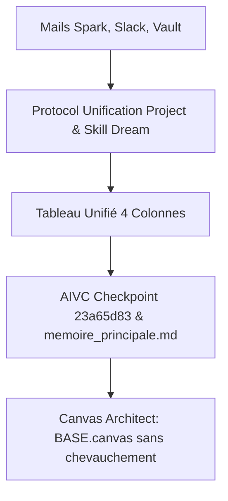

# 🌙 Rapport de Consolidation Mémorielle & Unification des Projets (Dream) — 2026-08-10

> [!NOTE]
> **Période scannée (Horodatage incrémental)** : du `2026-08-10T09:30:00+02:00` au `2026-08-10T17:22:00+02:00`  
> **Statut global** : 🟢 4 notes Vault + 4 e-mails + 5 canaux Slack scannés · Consolidation des fiches projets & Skill Dream mis à jour · Mémoire AIVC & BASE.canvas structurés

---

## 📌 Tableau Synthétique Unifié des Projets & Découvertes

| Projet & Note Cible | Statut | Information Découverte & Audit | Source(s) |
|:---|:---:|:---|:---|
| [`Suivi de Master Tatiana von Erlach.md`](file:///C:/Users/hjamet/Documents/VoiceNotes/notes/Suivi%20de%20Master%20Tatiana%20von%20Erlach.md) | ➕ | **Fiche maîtresse de suivi créée** (`deadline: 2027-02-01`). Étude expérimentale LLMs suisses (*Aperture* 8B/70B) vs *GLM 5.2* vs *Copilot* pour la DGTP Vaud. Historique des réunions indexé. | 📝 [Suivi Master Tatiana](file:///C:/Users/hjamet/Documents/VoiceNotes/notes/Suivi%20de%20Master%20Tatiana%20von%20Erlach.md) · 📝 [Compte-Rendu 10 août](file:///C:/Users/hjamet/Documents/VoiceNotes/voicenotes/Encadrement%20de%20m%C3%A9moire%20de%20master%20%20%C3%A9valuation%20de%20LLM%20suisses%20pour%20l%E2%80%99%C3%A9ducation.md) |
| [`Jeu Educatif LLM AAAI EAAI.md`](file:///C:/Users/hjamet/Documents/VoiceNotes/notes/Jeu%20Educatif%20LLM%20AAAI%20EAAI.md) | ➕ | **Fiche maîtresse créée pour le jeu éducatif LLM** (*LATENT SPACE: The Alignment Race*, `deadline: 2026-09-15`). Soirée test du 18 août 2026 avec Stergios, Amir, Henri, James. | 📝 [Fiche Jeu AAAI EAAI](file:///C:/Users/hjamet/Documents/VoiceNotes/notes/Jeu%20Educatif%20LLM%20AAAI%20EAAI.md) · 📬 E-mail Spark (Stergios) |
| [`AIVC.md`](file:///C:/Users/hjamet/Documents/VoiceNotes/AIVC.md) | ✨ | **Nouvelle conférence cible FAccT 2027** ([Call for Papers](https://facctconference.org/2027/cfp.html)). Deadline abstract : **27 octobre 2026** (`deadline: 2026-10-27`). Étude comparative engagée avec Amir. | 📝 [Fiche Projet AIVC](file:///C:/Users/hjamet/Documents/VoiceNotes/AIVC.md) · 🌐 [FAccT 2027 CFP](https://facctconference.org/2027/cfp.html) |
| [`Asharde.md`](file:///C:/Users/hjamet/Documents/VoiceNotes/notes/Asharde.md) | 🟢 | **Fiche maîtresse unique consolidée dans `notes/Asharde.md`** (`deadline: 2026-09-15`). Suppression du doublon frontmatter dans la note racine `Asharde.md` (convertie en index encyclopédique). | 📝 [Fiche Maitresse Asharde](file:///C:/Users/hjamet/Documents/VoiceNotes/notes/Asharde.md) · 🔍 Audit Project-Memory |
| [`Digital Language Learning Platform.md`](file:///C:/Users/hjamet/Documents/VoiceNotes/notes/Digital%20Language%20Learning%20Platform.md) | 🔴 | **Échéance imminente au 12 août (dans 48h)** pour le déploiement Hetzner, la préinscription OSF et l'amendement éthique Prolific (600 CHF). | 📝 [DLLP Note](file:///C:/Users/hjamet/Documents/VoiceNotes/notes/Digital%20Language%20Learning%20Platform.md) · 📝 [Éthique LOOP](file:///C:/Users/hjamet/Documents/VoiceNotes/notes/Reponses%20et%20Commentaires%20Soumission%20Ethique%20UNIL.md) |
| [`Mazic.md`](file:///C:/Users/hjamet/Documents/VoiceNotes/notes/Mazic.md) | ➕ | **Nouveau projet de jeu vidéo d'exploration de labyrinthes procéduraux** avec brouillard de guerre et mécanique de sortilèges (*Mazic Spells*), stack TypeScript/Canvas ECS (`github.com/hjamet/mazic`). | 📝 [Mazic Note](file:///C:/Users/hjamet/Documents/VoiceNotes/notes/Mazic.md) |
| [`Cluster-CI.md`](file:///C:/Users/hjamet/Documents/VoiceNotes/Cluster-CI.md) | ✨ | **Brouillon Spark rédigé pour Johannes-Rudolf David (ID `60757`)** expliquant le traitement des datasets confidentiels hors GitHub via VPN UNIL et montage local `/data`. | 📬 E-mail Spark (Johannes) · 📝 [Cluster-CI](file:///C:/Users/hjamet/Documents/VoiceNotes/Cluster-CI.md) |
| [`Organisation du cours Artificial Intelligence in Business 2026.md`](file:///C:/Users/hjamet/Documents/VoiceNotes/Organisation%20du%20cours%20Artificial%20Intelligence%20in%20Business%202026.md) | ✨ | **Réunion des TAs AIB à fixer**, création de la page Moodle AIB 2026 requise, intervenants invités validés (Ralf et Estevan). | 💬 Slack `#aib2026` · 📝 [AIB 2026 Note](file:///C:/Users/hjamet/Documents/VoiceNotes/Organisation%20du%20cours%20Artificial%20Intelligence%20in%20Business%202026.md) |

> [!TIP]
> **Légende des Statuts (Emoji Pur Exclusif)** :  
> ➕ *Création de projet* · ✨ *Ajout d'informations* · 🔴 *Urgence augmentée* · 🟢 *Urgence diminuée*

---

## 🔄 Traçabilité & Flux Système

