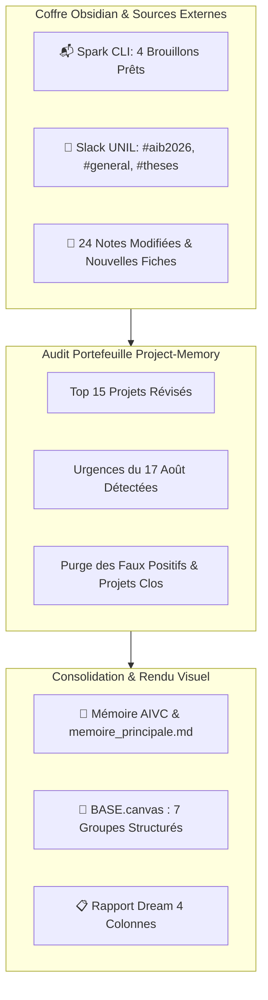

# 🌙 Rapport de Consolidation Mémorielle (Dream) — 2026-08-17

> [!NOTE]
> **Période scannée (Horodatage incrémental)** : du `2026-08-14T12:20:00+02:00` au `2026-08-17T11:15:00+02:00`  
> **Statut global** : 🟢 24 notes analysées · Audit 24 projets (Top 15 audité) · Mémoire AIVC consignée · [BASE.canvas](file:///C:/Users/hjamet/Documents/VoiceNotes/BASE.canvas) structuré sans chevauchement

---

## 📌 Tableau Synthétique Unifié des Projets & Découvertes

| Projet & Note Cible | Statut | Information Découverte & Audit | Source(s) |
| :--- | :---: | :--- | :--- |
| [`Fiancailles Amir et Dorsa.md`](file:///C:/Users/hjamet/Documents/VoiceNotes/notes/Fiancailles%20Amir%20et%20Dorsa.md) | 🏁 | **Vœux manuscrits & stéganographie** : Rédaction de 3 versions anglaises, 2 françaises et 4 formules de message caché par espacement. Recommandation majeure : *« I hope you truly find happiness »* sur Post-it 76×76 mm. Projet clôturé. | 📝 [`Fiancailles Amir et Dorsa.md`](file:///C:/Users/hjamet/Documents/VoiceNotes/notes/Fiancailles%20Amir%20et%20Dorsa.md) |
| [`Survey IA et Apprentissage des Langues.md`](file:///C:/Users/hjamet/Documents/VoiceNotes/notes/Survey%20IA%20et%20Apprentissage%20des%20Langues.md) | ✨ | **Revue systématique ACM CSUR (Impact Factor ~16.6)** : SLR PRISMA + Taxonomie conceptuelle 4 axes, modélisation Cognitive Load Theory (Sweller) et frontière de Pareto. 3 sous-notes méthodologiques créées. Dépôt LaTeX et Overleaf initialisés. Score **100.20**. | 📝 [`Survey IA et Apprentissage des Langues.md`](file:///C:/Users/hjamet/Documents/VoiceNotes/notes/Survey%20IA%20et%20Apprentissage%20des%20Langues.md) 📝 [`Typologies et Structures...`](file:///C:/Users/hjamet/Documents/VoiceNotes/notes/Typologies%20et%20Structures%20des%20Surveys%20Academiques.md) |
| [`AIVC.md`](file:///C:/Users/hjamet/Documents/VoiceNotes/AIVC.md) | ✨ | **Roadmap Européenne & Validation Cluster GB10** : Cœur de cible MSR 2027 (Dublin, 23 oct), FAccT et ICPC. Pipeline DVC validé (SWE-bench-CL, DevBench, Agentic RAG / Tool Call Decay), exécution réussie sur Grace Blackwell (`ca3353f`). Score **100.00**. | 📝 [`AIVC.md`](file:///C:/Users/hjamet/Documents/VoiceNotes/AIVC.md) |
| [`Organisation du cours Artificial Intelligence in Business 2026.md`](file:///C:/Users/hjamet/Documents/VoiceNotes/Organisation%20du%20cours%20Artificial%20Intelligence%20in%20Business%202026.md) | 🔴 | **Hausse du niveau technique & Logistique Moodle** : Yash souhaite un cours plus technique (GenAI, RAG, SmolAgents, MCP). 3 intervenants invités (Ralf, Estevan, 3e TBD). Coordination TAs et création du Moodle. Score réhaussé à **52.00**. | 💬 Slack `#aib2026` 📝 [`Organisation du cours...`](file:///C:/Users/hjamet/Documents/VoiceNotes/Organisation%20du%20cours%20Artificial%20Intelligence%20in%20Business%202026.md) |
| [`Organisation du rattrapage AIB pour Nil Socias Noya.md`](file:///C:/Users/hjamet/Documents/VoiceNotes/Organisation%20du%20rattrapage%20AIB%20pour%20Nil%20Socias%20Noya.md) | 🏁 | **Échéance 17 Août & Pack Teams/Canvas** : Déclaration officielle HEC due ce jour. Pack zip complet partagé à Yuanjun (11 datasets CSV, guide évaluateur, corrigés sans IA). Créneaux proposés (18-20 août), attente confirmation salle. Tâche finalisée. | 📬 E-mails Spark 💬 Slack `#aib2026` 📝 [`Organisation du rattrapage...`](file:///C:/Users/hjamet/Documents/VoiceNotes/Organisation%20du%20rattrapage%20AIB%20pour%20Nil%20Socias%20Noya.md) |
| [`LLM as a Recommender.md`](file:///C:/Users/hjamet/Documents/VoiceNotes/notes/LLM%20as%20a%20Recommender.md) | ✨ | **Pivot Stratégique vers ECIR 2027 (CORE A)** : Rejet WISE 811 transformé en opportunité de resoumission (Abstract 21 sept, Full Paper 5 oct). Plan de révision arrêté (corrections factuelles + baseline SASRec). Brouillon Spark prêt pour Michalis et Yash (ID `60901`). Score **86.00**. | 📬 Brouillon Spark `60901` 📝 [`LLM as a Recommender.md`](file:///C:/Users/hjamet/Documents/VoiceNotes/notes/LLM%20as%20a%20Recommender.md) |
| [`Gestion de la SCI Hellenvilliers.md`](file:///C:/Users/hjamet/Documents/VoiceNotes/notes/Gestion%20de%20la%20SCI%20Hellenvilliers.md) | ✨ | **Coordination Opérationnelle & Plan d'Économies** : Henri désigné coordinateur/gérant à l'AG du 9 août. Passage en CCA (50 €/mois/branche). Actions : rassembler 3 CNI, PV d'AG bancaire, bascule EDF Tempo (-2500 à -3500 €/an). Score **81.80**. | 📝 [`Gestion de la SCI Hellenvilliers.md`](file:///C:/Users/hjamet/Documents/VoiceNotes/notes/Gestion%20de%20la%20SCI%20Hellenvilliers.md) |
| [`JDR Planner.md`](file:///C:/Users/hjamet/Documents/VoiceNotes/notes/JDR%20Planner.md) | ✨ | **Mise en Ligne & Déploiement Vercel/Supabase** : Web app opérationnelle en production ([jdr-planner.vercel.app](https://jdr-planner.vercel.app)), calcul d'optimisation de créneaux validé pour la session Vampire du 27 août. Prochaine étape : bot Discord et alertes Resend. Score **84.58**. | 📝 [`JDR Planner.md`](file:///C:/Users/hjamet/Documents/VoiceNotes/notes/JDR%20Planner.md) |
| `Suivi de Master Guillaume Grand` | ✨ | **Cadrage Stage Vonlanthen** : Sujet initial de transcription Teams annulé par l'entreprise. Brouillon Spark rassurant rédigé (ID `60928`) proposant de profiter de l'été et de cadrer le sujet à la rentrée (15 sept). | 📬 Brouillon Spark `60928` |
| `Cluster-CI` | ✨ | **Validation Mode Local & Déploiement P2P** : Johannes-Rudolf a confirmé le bon fonctionnement de `cluster-run --local` (commit `5890c31`). Brouillon Spark de validation prêt (ID `60926`). | 📬 Brouillon Spark `60926` |
| [`Apprentissage avec NotebookLM et Readwise.md`](file:///C:/Users/hjamet/Documents/VoiceNotes/notes/Apprentissage%20avec%20NotebookLM%20et%20Readwise.md) | ➕ | **Boucle de Veille & Capture PKM** : Pipeline Recherche Google AI $\to$ Synthèse NotebookLM $\to$ Readwise $\to$ Obsidian. Création de carnets thématiques NLP/Agents. Score **60.70**. | 📝 [`Apprentissage avec NotebookLM...`](file:///C:/Users/hjamet/Documents/VoiceNotes/notes/Apprentissage%20avec%20NotebookLM%20et%20Readwise.md) |
| `Soirée des Masters HEC 16 sept 2026` | 🔴 | **Alerte Logistique Immédiate (17 Août)** : Action requise ce jour pour faire le point sur le matériel du stand MScIS et informer Sandy Mazet. Score **61.80**. | 📝 `Soirée des Masters HEC...` |
| `Supervision Master DGEP Vaud` | ➕ | **Nouvelle Demande de Supervision AAIL** : Soumission d'un étudiant pour un stage en entreprise à la DGEP Vaud avec Henri Jamet sélectionné comme superviseur souhaité. | 💬 Slack `#master-thesis-updates` |
| [`Revue des articles pour EMCL PKDD.md`](file:///C:/Users/hjamet/Documents/VoiceNotes/Revue%20des%20articles%20pour%20EMCL%20PKDD.md) | 🏁 | **Clôture & Purge d'Obsolescence** : Évaluation pour ECML PKDD terminée en mars 2026. Fiche taggée `done` et définitivement retirée du suivi de projets actifs. | 📝 [`Revue des articles...`](file:///C:/Users/hjamet/Documents/VoiceNotes/Revue%20des%20articles%20pour%20EMCL%20PKDD.md) |
| [`Faire du violoncelle et repenser ma to-do list.md`](file:///C:/Users/hjamet/Documents/VoiceNotes/voicenotes/Faire%20du%20violoncelle%20et%20repenser%20ma%20to-do%20list.md) | 📦 | **Reclassement en Non-Projet** : Réflexion vocale personnelle sans livrable ni feuille de route. Tags `#todo` retirés et fiche purgée de la mémoire active. | 📝 [`Faire du violoncelle...`](file:///C:/Users/hjamet/Documents/VoiceNotes/voicenotes/Faire%20du%20violoncelle%20et%20repenser%20ma%20to-do%20list.md) |

> [!TIP]
> **Légende des Statuts (Emoji Pur Exclusif)** :  
> ➕ *Création de projet* · ✨ *Ajout d'informations* · 🔴 *Urgence augmentée* · 🟢 *Urgence diminuée* · 🏁 *Projet terminé* · 📦 *Déclassifié / Non-projet*

---

## 🗺️ Visualisation BASE.canvas (Zéro Chevauchement)

Le fichier [BASE.canvas](file:///C:/Users/hjamet/Documents/VoiceNotes/BASE.canvas) regroupe désormais **67 nœuds** et **54 connecteurs annotés** répartis en 7 zones thématiques étanches :

---

## ⚡ Actions Prioritaires Suggérées pour la Journée

1. **Déclaration Officielle Rattrapage AIB** : Envoyer la confirmation au secrétariat HEC (`hecbachelor@unil.ch` / Flavio Palmerini & Stéphane Guérard) pour l'examen de Nil Socias Noya.
2. **Logistique Stand Masters MScIS** : Confirmer les besoins de matériel avec Sandy Mazet pour la soirée du 16 septembre.
3. **Vœux Fiançailles Amir & Dorsa** : Choisir la formule définitive et calligraphier le mot manuscrit stéganographique (*« I hope you truly find happiness »*).
4. **Revue des Brouillons Spark** : Valider et envoyer les brouillons préparés pour Guillaume Grand (`60928`), Michalis/Yash (`60901`) et Johannes-Rudolf (`60926`).
