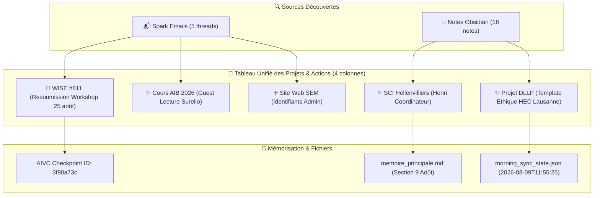

# 🌅 Rapport de Veille Matinale — 9 Août 2026

> [!NOTE]
> **Période scannée (Horodatage incrémental)** : du `2026-08-07T14:30:00+02:00` au `2026-08-09T11:55:25+02:00`  
> **Statut global** : 🟢 5 fils e-mails analysés · 18 notes Obsidian scannées · 6 projets traités · AIVC à jour

---

## 📌 Tableau Synthétique Unifié des Projets & Découvertes

| Projet & Note Cible | Statut | Information Découverte | Source(s) |
|:---|:---:|:---|:---|
| [`Bilan et Strategie de Revision WISE 811.md`](file:///C:/Users/hjamet/Documents/VoiceNotes/Bilan%20et%20Strategie%20de%20Revision%20WISE%20811.md) | 🔴 | **Refus conf. principale** WISE 811 (*SLM as Rerankers*) + CFP **Workshop AI4Good** (Deadline: **25 Août 2026**) | 📬 [Mail Spark 60705](spark://thread/60705) |
| [`Réunion familiale SCI Hellenvilliers.md`](file:///C:/Users/hjamet/Documents/VoiceNotes/voicenotes/R%C3%A9union%20familiale%20sur%20la%20SCI%20:%20maintien,%20budget%2050%20%E2%82%AC%20et%20coordination.md) | ✨ | **Maintien SCI validé**, **50 €/mois** par branche, **Henri Coordinateur**, **Charte de l'envie de vivre**, **VPS Allemagne** | 📝 [Note Audio SCI](file:///C:/Users/hjamet/Documents/VoiceNotes/voicenotes/R%C3%A9union%20familiale%20sur%20la%20SCI%20:%20maintien,%20budget%2050%20%E2%82%AC%20et%20coordination.md) |
| [`Guest lecture on AI Safety & Security.md`](file:///C:/Users/hjamet/Documents/VoiceNotes/voicenotes/Guest%20lecture%20on%20AI%20Safety%20&%20Security.md) | ✨ | **Gaetan Stein (Surelio)** disponible les jeudis (**12 oct – 26 nov**) pour **Guest Lecture 90 min** | 📬 [Mail Spark 60702](spark://thread/60702) |
| **DLLP** — [`Template Soumission Ethique HEC Lausanne.md`](file:///C:/Users/hjamet/Documents/VoiceNotes/Template%20Soumission%20Ethique%20HEC%20Lausanne.md) | ✨ | **Trame officielle Master Template** pour validation éthique des **études utilisateurs HEC UNIL & iTalki** | 📝 [Template Ethique HEC](file:///C:/Users/hjamet/Documents/VoiceNotes/Template%20Soumission%20Ethique%20HEC%20Lausanne.md) |
| [`Idées discours mariage Antoine et Marguerite.md`](file:///C:/Users/hjamet/Documents/VoiceNotes/voicenotes/Id%C3%A9es%20de%20discours%20de%20mariage%20litt%C3%A9raire%20pour%20Antoine%20et%20Marguerite.md) | ✨ | **Remue-méninges littéraire** (24m44s) basé sur le faire-part et auteurs classiques | 📝 [Note Audio Discours](file:///C:/Users/hjamet/Documents/VoiceNotes/voicenotes/Id%C3%A9es%20de%20discours%20de%20mariage%20litt%C3%A9raire%20pour%20Antoine%20et%20Marguerite.md) |
| [`Accès site internet Association SEM.md`](file:///C:/Users/hjamet/Documents/VoiceNotes/administratif) | ➕ | **Identifiants admin site Web SEM** (`sem-admin` / `NuC9IB4R%mclcsgP`) | 📬 [Mail Spark 60713](spark://thread/60713) |

> [!TIP]
> **Légende des Statuts (Emoji Pur Exclusif)** :  
> ➕ *Création de projet* · ✨ *Ajout d'informations* · 🔴 *Urgence augmentée* · 🟢 *Urgence diminuée*

---

## 🔄 Traçabilité & Flux Système

---

## 🔒 Connecteurs & Sécurité

> [!IMPORTANT]
> - **Sécurité** : 100% Lecture Seule sur services externes. Aucun email envoyé.
> - **Spark CLI** : 🟢 Connecté et opérationnel (5 threads analysés).
> - **Obsidian Scanner** : 🟢 18 notes récentes modifiées analysées.
> - **Composio CLI** : 🛠️ Enregistrement de la clé API configuré via sous-agent.
