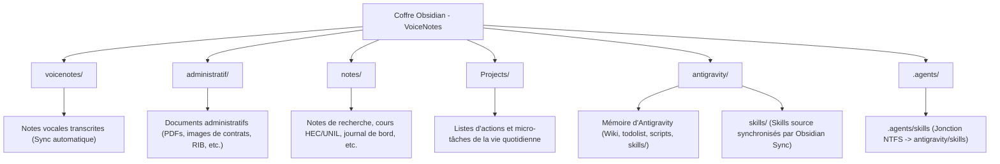

# Structure du Coffre Obsidian (VoiceNotes Sync)

Ce document récapitule l'organisation générale du coffre pour guider les recherches et l'exploration de l'agent Antigravity.

---

## 📁 Répertoires Clés & Contenus

### 1. `voicenotes/`
* **Description** : Notes textuelles issues des enregistrements audio de Henri.
* **Intérêt pour l'agent** : Permet de capter les pensées à la volée, les retours de réunions, les idées de recherche et les rappels quotidiens.
* **Exemples de fichiers** :
  - [Accident avec camionnette Sixt - Questions sur frais de réparation.md](file:///C:/Users/hjamet/Documents/VoiceNotes/voicenotes/Accident%20avec%20camionnette%20Sixt%20%20Questions%20sur%20frais%20de%20r%C3%A9paration.md)
  - [Discussion about master's thesis project and administrative processes.md](file:///C:/Users/hjamet/Documents/VoiceNotes/voicenotes/Discussion%20about%20master's%20thesis%20project%20and%20administrative%20processes.md)

### 2. `administratif/`
* **Description** : Documents administratifs numérisés (PDFs, PNG, JPG).
* **Intérêt pour l'agent** : Source d'information officielle et exacte pour remplir les formulaires ou rédiger des courriers de réclamation/résiliation.
* **Exemples de fichiers** :
  - Contrats de travail UNIL
  - Permis de séjour B suisse
  - Offres d'assurances Sanitas / AXA
  - Lettre de clôture de banque française

### 3. `notes/`
* **Description** : Espace principal pour les documents structurés, la recherche scientifique (NLP, RAG, Recommender Systems) et les tableaux de bord.
* **Exemples de fichiers** :
  - [Project Dashboard - Henri Jamet.md](file:///C:/Users/hjamet/Documents/VoiceNotes/notes/Project%20Dashboard%20-%20Henri%20Jamet.md)
  - [Paiements réguliers.md](file:///C:/Users/hjamet/Documents/VoiceNotes/notes/Paiements%20r%C3%A9guliers.md)
  - [Fermer mon compte banquaire français.md](file:///C:/Users/hjamet/Documents/VoiceNotes/notes/Fermer%20mon%20compte%20banquaire%20fran%C3%A7ais.md)

### 4. `Projects/`
* **Description** : Micro-tâches concrètes à accomplir (courses, tâches administratives rapides, devoirs).
* **Exemples de fichiers** :
  - [Taxation ordinaire ultérieure – Gouv rembourse tous impots.  Frais de déplacement.md](file:///C:/Users/hjamet/Documents/VoiceNotes/Projects/Taxation%20ordinaire%20ult%C3%A9rieure%20%E2%80%93%20Gouv%20rembourse%20tous%20impots.%20%20Frais%20de%20d%C3%A9placement.md)

### 5. `antigravity/`
* **Description** : Mémoire exclusive de l'agent.
* **Contenu** :
  - [index_principal.md](file:///C:/Users/hjamet/Documents/VoiceNotes/antigravity/index_principal.md) : Point d'entrée du Wiki d'Antigravity.
  - [todolist.md](file:///C:/Users/hjamet/Documents/VoiceNotes/antigravity/todolist.md) : Suivi des tâches prioritaires.
  - [memoire_principale.md](file:///C:/Users/hjamet/Documents/VoiceNotes/antigravity/memoire_principale.md) : Profil consolidé de Henri Jamet.
  - [structure_coffre.md](file:///C:/Users/hjamet/Documents/VoiceNotes/antigravity/structure_coffre.md) : La présente cartographie.
  - `antigravity/souvenirs/` : Dossier contenant les fiches Wikipédia thématiques interconnectées.
  - `antigravity/skills/` : **Dossier source des compétences (Skills)**, visible et synchronisé automatiquement par Obsidian Sync vers tous les appareils.
  - `antigravity/scripts/` : Espace pour les utilitaires de traitement (ex. scans de tâches, scripts d'extraction).
  - `antigravity/drafts/` : Espace pour les brouillons générés.

### 6. `.agents/`
* **Description** : Configuration technique et points d'ancrage pour l'IDE Antigravity.
* **Architecture Skills** : `.agents/skills` est une **jonction de répertoire NTFS** (`mklink /J`) pointant de manière transparente vers `antigravity/skills`. Cela permet à Antigravity de découvrir et charger 100% des compétences tout en garantissant que les fichiers sources sont synchronisés par Obsidian Sync sans duplication.
