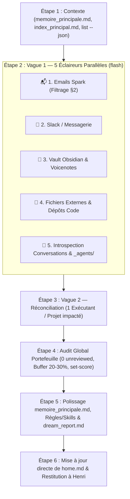

# 🌙 Skill Dream — Consolidation Mémorielle, Veille & Introspection Méta-Cognitive

> [!TIP]
> **Orchestration Multi-Agents par Sources, Projets & Introspection Système** : Architecture modulaire où l'exploration est parallélisée en 5 éclaireurs spécialisés (Emails Spark, Slack, Coffre Obsidian, Fichiers/Code, et **Introspection Méta-Cognitive des Conversations & de `_agents/`**), la réconciliation est isolée (1 exécutant par projet impacté), et l'audit global de portefeuille, le polissage mémoriel (`memoire_principale.md`), l'amélioration des règles/skills et le cockpit (`home.md`) sont pilotés directement par le superviseur.
> **Règles transversales** : Ce skill applique [superviseur-aveugle.md](file:///c:/Users/hjamet/Documents/VoiceNotes/_agents/rules/superviseur-aveugle.md), [sous-agents.md](file:///c:/Users/hjamet/Documents/VoiceNotes/_agents/rules/sous-agents.md), [coffre-obsidian.md](file:///c:/Users/hjamet/Documents/VoiceNotes/_agents/rules/coffre-obsidian.md) et [zero-trust.md](file:///c:/Users/hjamet/Documents/VoiceNotes/_agents/rules/zero-trust.md).

---

## 🧭 1. Philosophie & Deux Modes de Fonctionnement

Le skill **Dream** (en référence au processus biologique de consolidation nocturne et de restructuration synaptique) assure à la fois la **veille opérationnelle** sur les projets d'Henri Jamet et l'**introspection méta-cognitive** de l'agent (analyse des conversations récentes, amélioration continue des règles/skills/scripts/notes internes et conseils stratégiques).

1. **Mode Global / Périodique (`/dream` sans argument)** :
   - **Sas Asynchrone `Dream_Inbox` (Google Drive — Pont Vocal Gemini $\to$ Antigravity), Boucle Événementielle `watch-inbox` & Exemption de durée obligatoire de 45 min** *(décisions d'Henri, 28/10 & 03/11/2026)* : À chaque exécution de `/dream` (ou du projet `🤖 Consolidation et Exploration Dream`), l'agent inspecte systématiquement le dossier Google Drive **`Dream_Inbox`** (à la racine du Drive). Pour chaque Google Doc trouvé dans `Dream_Inbox`, `/dream` lit la synthèse ainsi que la section **Verbatim Exact d'Henri**, intègre les décisions et citations exactes dans les notes maîtresses Obsidian concernées (conformément à [`coffre-obsidian.md`](file:///c:/Users/hjamet/Documents/VoiceNotes/_agents/rules/coffre-obsidian.md)), crée les nouvelles tâches (`task_status: "new"`) dans AIVC via `remember`, ajuste les priorités (`set-score`) si nécessaire, puis **supprime (ou met à la corbeille) le Google Doc de `Dream_Inbox`** une fois son contenu intégralement consigné dans Obsidian et AIVC afin que le dossier `Dream_Inbox` reste systématiquement vide et propre après traitement. Lorsqu'un document est capté en direct par la boucle événementielle `watch-inbox` (`python -m aivc.cli dream-inbox watch`), le script sauvegarde immédiatement une copie locale du texte dans `C:\Users\Public\aivc\dream_inbox_archive\`, **supprime aussitôt le fichier de Google Drive dès le tout début de la tâche** (avant même l'appel à `agy.exe --mode auto --model gemini-4-argon-high -p`, évitant toute réexécution en cas de bug), et réveille l'agent principal qui identifie tous les projets ciblés et **lance en parallèle un sous-agent `superviseur-projet` (`Model: 'inherit'`) par projet en lui transmettant directement le lien/chemin vers le fichier téléchargé localement sans jamais réécrire ni reformuler le propos d'Henri**. Lorsque `Dream_Inbox` est vide et qu'aucun agent ne tourne, `watch-inbox` interroge `project_memory_cli.py next-autonomous --json` pour sélectionner le 1er projet le plus urgent (selon le score effectif avec malus de récence, **sans seuil de priorité minimum** afin de réveiller progressivement les projets dormants) qui ne possède **aucune tâche au statut `await_validation`**, et lance 1 unique agent autonome en mode `/one-shot` (`1 projet = 1 tâche new réalisable`, ou la tâche récurrente universelle `[ockham-<slug>]` « Rasoir d'Ockham »), qui travaille directement sur la branche principale (`main` / `master`) sans jamais commettre d'action irréversible ou impliquant un tiers, soumet son livrable en `await_validation` via `task_commit` et applique `feedback "<Projet>" ok --agent` avant de rendre la main à `watch-inbox`. De plus, le projet `🤖 Consolidation et Exploration Dream` n'a **aucune obligation de durer 45 minutes** : dès qu'il a terminé son travail de consolidation mémorielle et de purge de `Dream_Inbox`, il s'arrête immédiatement.
   - **Vague 1 (5 Éclaireurs parallèles par source)** : (1) Emails Spark filtrés, (2) Slack/Messagerie, (3) Coffre Obsidian, Voicenotes & **Dossier Google Drive `Dream_Inbox`**, (4) Fichiers externes & Dépôts de code, (5) **Introspection Méta-Cognitive (Transcripts des conversations récentes `brain/*` depuis le dernier Dream + Audit d'hygiène de `_agents/` : `rules/`, `skills/`, `scripts-for-skills/`, `memory/`)**.
   - **🛑 FRONTIÈRE ÉTANCHE `/dream` vs `/advance` (Zéro Diagnostic, Zéro Résolution de Bug, Zéro Exécution de Tâche)** *(décision d'Henri, 27/10/2026)* : Ce n'est **jamais** à `/dream` de trouver les réponses aux questions, d'investiguer/diagnostiquer la source des bugs ni d'exécuter ou gérer les tâches. `/dream` fait **uniquement la recherche minimale pour comprendre le contexte des nouvelles données entrantes** (courriels, Slack, notes quotidiennes `JJ-MM-AAAA.md`, voicenotes, commits, tirage du graphe), puis **consigne, organise, lie les éléments entre eux (`[[...]]`), met à jour les feuilles de route (`- [ ]`) et les notes maîtresses de projets (`notes/<Projet>.md`), et calibre les priorités (`set-score`)**. C'est ensuite [`/advance`](file:///c:/Users/hjamet/Documents/VoiceNotes/_agents/skills/advance/SKILL.md) qui traitera ces tâches, mènera les diagnostics et résoudra les problèmes lorsque ce sera le tour du projet !
   - **Vague 2 ($N$ Exécutants de Réconciliation des Notes)** : 1 sous-agent dédié par projet impacté pour mettre à jour sa note maîtresse selon le format Question-Réponse de `coffre-obsidian.md` (capture des actifs 🔐, roadmap `- [ ]`, liens entre notes, calibrage `set-score`) — **sans jamais coder, diagnostiquer ni exécuter les tâches**.
   - **Consolidation & Cockpit (Superviseur Direct)** : Garantie `0 unreviewed`, contrôle réaliste de la marge calendaire (buffer 20–30 %), polissage de `_agents/memory/memoire_principale.md`, mise à jour directe des `.md` de gouvernance perfectibles (`_agents/rules/*.md`, `_agents/skills/*/SKILL.md`), génération de `dream_report.md` (4 sections : Projets, Nouveaux projets, Top 10 priorités, et **Bilan Méta-Cognitif & Conseils à Henri**), et mise à jour directe de `home.md`.
2. **Mode Ciblé / Granulaire (`/dream <cible>`)** :
   - Ingestion chirurgicale d'une cible explicite (voicenote, note de projet, courriel, PDF) sans scanner global, réconciliation in-situ de la note maîtresse (avec illustration 16:9 si création/refonte), calibrage `set-score`, garantie `0 unreviewed`, et mise à jour de `memoire_principale.md` et `home.md`.

> [!CAUTION]
> **🔐 VERROUILLAGE SÉCURITÉ & EXEMPTION FEEDBACK**
> - **Aucun envoi automatique d'email ou de message** (`spark action send` est STRICTEMENT INTERDIT ; seuls les brouillons sont permis).
> - **Zéro `ask_question` de ressenti** : Dream est un cycle de veille et de maintenance mémorielle ; il se clôture directement sans pop-up `ask_question` (cf. [pomodoro-projets.md](file:///c:/Users/hjamet/Documents/VoiceNotes/_agents/rules/pomodoro-projets.md)).

---

## 🛡️ 2. Filtrage Anti-Bruit & Anti-Marketing Draconien (Email Scanner Spark)

> [!WARNING]
> **RÈGLE CARDINALE** : Si un courriel provient d'un expéditeur automatisé ET n'exige aucune action humaine directe et personnalisée d'Henri pour ses projets réels ⟹ **L'IGNORER TOTALEMENT** (zéro projet créé, zéro action inscrite). En cas de doute, ignorer (faux négatif toléré, faux positif interdit).

| Catégorie | Règle | Exemples Concrets |
| :--- | :--- | :--- |
| **🚫 Blacklist (Ignorer)** | Newsletters, marketing, notifications automatisées de plateformes tierces, alertes OAuth de routine, reçus de transport quotidiens, rapports bancaires automatisés | Promotions SaaS, annonces de modèles (Regolo, OpenAI, Anthropic, AWS, Vercel, GitHub hors alerte sécurité vitale ou facture en échec), reçus CFF quotidiens |
| **✅ Whitelist (Traiter)** | Personnes physiques identifiées, administrations officielles personnalisées, décisions éditoriales formelles | **UNIL/HEC/EPFL** (Prof. Yash Raj Shrestha, Prof. Michalis Vlachos, Prof. Pamela Delgado, Yuanjun Feng, Leping Li, Johannes David, Elyes Benchaabane, Amir Bashardoust) · **Étudiants/TAs** (Vânia Pereira, Melvyn Huynh, Guillaume Grand, Gizay Ceylan, Ismael Ouarit Martínez, étudiants AIB) · **Admin & Conférences** (SPoMi, RH UNIL, Décanat HEC, SEPASE, DGFiP, Notaire, TheWebConf/WWW, OpenReview, DMKD, AAAI, ECIR, MSR, FAccT, AAMAS) · **Famille & Proches** (Frédéric, Élisabeth, Joséphine, Marguerite, Hortense, Julien, Annabelle) |

---

## 🎯 3. Règles d'Or de Réconciliation des Projets & d'Introspection Méta-Cognitive

### 3.1 Distinction Stricte `deadline:` vs `milestone:` vs Historique Passé
1. **`deadline: YYYY-MM-DD` (Date Limite Dure)** : Réservé aux échéances réelles et contraignantes (soumissions d'articles, dépôts de fonds de recherche, démarches légales/administratives, engagements contractuels). Aucun projet créatif ou personnel sans contrainte externe ne reçoit de deadline artificielle.
2. **`milestone:` (Jalon Synchrone avec un Tiers)** : Réservé **exclusivement** aux réunions, oraux ou synchronisations d'équipe planifiées (`YYYY-MM-DD`, `"mercredi"`, `"0 14 * * 3"`, `@weekly`), accompagné optionnellement de `next_milestone: "..."`. **Interdiction formelle** d'inventer un `milestone:` pour une étape interne de code/rédaction ou à partir d'une expression orale floue (« d'ici une semaine » ➔ simple tâche `- [ ]` dans la roadmap).
3. **Zéro Échéance Passée** : Toute date antérieure ou révolue (< date/heure du jour) appartient à l'historique de la note et doit être purgée des champs frontmatter `deadline:` / `milestone:` et des tableaux d'échéances futures.

### 3.2 Réconciliation Non-Destructive, Section `## Skills`, Actifs Critiques 🔐 & Conventions du Coffre
Chaque projet impacté est mis à jour dans sa note maîtresse unique (`notes/<Nom du Projet>.md` ou racine) selon [coffre-obsidian.md](file:///c:/Users/hjamet/Documents/VoiceNotes/_agents/rules/coffre-obsidian.md) et [task-tracking.md](file:///c:/Users/hjamet/Documents/VoiceNotes/_agents/rules/task-tracking.md) :
- **Section `## Skills` en haut de note (Skills Intra-Projet à Chargement Paresseux)** : maintenir sous le H1 et l'illustration la section `## Skills` listant sous forme de puces `- [[skills/<nom>|Titre]] — <condition de lecture obligatoire en Lazy Loading>` les savoir-faire du projet stockés dans `skills/` (relation Many-to-Many, tracés dans `read_files` d'AIVC lorsqu'utilisés et affinés via `/learn` à taille constante par Rasoir d'Ockham).
- **Accumulation non-destructive** : ne jamais supprimer d'informations de fond ou d'historique ; replier les tâches achevées sous `

✅ Tâches Accomplies (Dernière Session [Date])
`.
- **Style Question-Réponse sourcé** : titres en questions explicites (`## ... ?`), 1–2 phrases d'explication directe, puis `Source : <ancre>` et citation exacte en bloc.
- **Capture systématique des actifs critiques 🔐** : consigner immédiatement tout URL, portail, identifiant, code de réunion Teams/Zoom, numéro de dossier ou contact technique.

### 3.3 Calibrage Agent (`set-score`) vs Session Utilisateur (`feedback`) & Rigueur Anti-Biais
- **En cycle Dream / Veille, utiliser EXCLUSIVEMENT `set-score "<Projet>" <score_1_100>`** (ou `feedback "<Projet>" finished` / `non-projet`). Ne **jamais** appeler `feedback ok / less-often / more-often` lors d'un cycle Dream afin de ne pas simuler une fausse session de travail d'Henri ($K=0.0$ préservé).
- **Sanctuarisation des projets clos (`status: completed` / `#done`)** : ne jamais réactiver ni scorer un projet clos sans demande explicite d'Henri.
- **Grille de Rigueur Réaliste (Anti-Sycophantie & Buffer 20–30 %)** :
  - Évaluer le temps restant en jours ouvrés réels face aux dépendances séquentielles incompressibles (passations Prolific, calculs GPU, rédaction LaTeX, relecture des directeurs à J-14).
  - Marge résiduelle $< 20\text{–}30\,\%$ ou blocage critique non résolu ➔ **Urgence critique (`set-score` 85–100)** et signalement franc à Henri.
  - Marge confortable ($> 30\,\%$) ➔ **Rythme nominal (`set-score` 40–75)**.
  - Projet très en avance ou sans échéance proche ➔ **Espacement (`set-score` 10–35)**.

### 3.4 🧠 Introspection Méta-Cognitive & Auto-Amélioration (`_agents/` & Conversations)
À chaque cycle `/dream` global, l'éclaireur méta-cognitif et le superviseur analysent :
1. **Les conversations récentes (`<appDataDir>\brain\<conv-id>\`)** intervenues depuis le dernier `last_sync_timestamp` :
   - Quelles corrections, préférences ou remarques récurrentes Henri a-t-il formulées ?
   - Quels blocages techniques, erreurs d'outils, dérives de sous-agents ou pertes de temps ont eu lieu ?
   - Quelles tâches ou suivis implicites évoqués en conversation risquent d'être oubliés s'ils ne sont pas ancrés dans les notes de projet ?
2. **L'hygiène et la pertinence de `_agents/`** (`rules/*.md`, `agents/*.md`, `skills/*/SKILL.md`, `scripts-for-skills/`, `memory/memoire_principale.md`, `memory/index_principal.md`) :
   - **Auto-correction immédiate des `.md` de gouvernance et de mémoire par le superviseur ($P=0$)** : purge des règles dupliquées ou obsolètes dans `memoire_principale.md`, alignement DRY des skills avec `_agents/rules/` *(Note Multi-PC : Henri utilise deux postes Windows synchronisés, `C:\Users\hjamet\` à l'UNIL et `C:\Users\Jamet\` sur son PC personnel — aucun de ces deux chemins n'est une erreur)*.
   - **Propositions d'améliorations et conseils à Henri** : améliorations d'outils/scripts à lancer, bonnes pratiques de workflow à adopter, et angles morts détectés sur l'équilibre de son portefeuille de projets.

---

## 🌐 4. Pipeline d'Exécution du Mode Global (6 Étapes)

### Étape 1 : Contexte Interne & État du Portefeuille (Superviseur $P=0$)
- Lire `_agents/memory/memoire_principale.md` et `_agents/memory/index_principal.md`.
- Exécuter `python "_agents/scripts-for-skills/project_memory_cli.py" list --top 35` (et `list --unreviewed --json`).

### Étape 2 : Vague 1 — 5 Éclaireurs Parallèles (`invoke_subagent`, `Model: 'flash'`)
Créer les 5 artefacts de questions (`questions_dream_emails.md`, `questions_dream_slack.md`, `questions_dream_vault.md`, `questions_dream_files.md`, `questions_dream_metacognition.md`) et déployer en parallèle 5 sous-agents `eclaireur` :
1. **Email Scanner Spark** : lit `morning_sync_state.json`, inspecte les courriels et brouillons récents via Spark CLI en appliquant le filtrage §2.
2. **Slack Scanner** : inspecte les échanges Slack récents (`#aib2026`, `#general`, DMs collègues/TAs).
3. **Vault & `Dream_Inbox` Scanner** : (a) inspecte le dossier Google Drive **`Dream_Inbox`** (`python -m aivc.cli dream-inbox list` / `read` ou `rclone lsf gdrive:Dream_Inbox` / `gdrive`) et extrait le contenu intégral (synthèse + section `Verbatim Exact d'Henri`) de chaque Google Doc présent ; (b) exécute `scan_obsidian_notes.py` en **deux appels distincts** (1° `python "_agents/scripts-for-skills/scan_obsidian_notes.py" --json` pour les notes et voicenotes modifiées depuis `last_sync_timestamp` ; 2° `python "_agents/scripts-for-skills/scan_obsidian_notes.py" --least-connected 1 --random-notes 5 --update-state --json` pour l'exploration de graphe et l'avancement de la file `visited_list`, car ces drapeaux court-circuitent `scan_notes()`), traque les deadlines/milestones passés dans les frontmatters, et évalue si le **nœud le moins connecté du coffre** ainsi que **5 notes tirées aléatoirement** peuvent être reliés à un projet existant et actif, mener à un nouveau projet ou améliorer un projet existant (en consignant toute proposition d'amélioration via un `remember` AIVC rattaché à `notes/<Projet>.md` dans `read_files`).
4. **External Files & Code Scanner** : inspecte `administratif/`, `~/Downloads/` et l'état Git (`git status`, derniers commits) des dépôts actifs de `~/Documents/code`.
5. **Meta-Cognitive & Conversations Scanner** : exécute `python "_agents/scripts-for-skills/token_telemetry_cli.py" --days 7` pour mesurer quantitativement la consommation de tokens, le ratio `flash`/`inherit`, **ainsi que l'utilisation de Claude Code (`claude_subagent.py` : appels, forces/faiblesses, quotas `QUOTA_SESSION_5H` et `QUOTA_WEEK_7D` vs cible linéaire 96 %)**, les tours moyens par rôle et les sessions lourdes, inspecte les conversations récentes dans `<appDataDir>\brain\*\` depuis `last_sync_timestamp` (demandes d'Henri, frictions, corrections) et audite la propreté des fichiers de `_agents/`.

### Étape 3 : Vague 2 — Réconciliation par Projet Impacté (`executant`) & Préparation sans Exécution Directe
- **Règle cardinale de `/dream` (« Simplement consigner, lier et organiser dans les notes de projets et AIVC pour que `/advance` les traite ensuite — même pas de diagnostic ! ») & Isolement strict `1 remember = 1 projet`** : `/dream` ne cherche **jamais** lui-même les réponses techniques, ne fait **aucun** diagnostic de bug et n'exécute **aucune** tâche ou modification de code/script. Il se contente de faire la recherche superficielle nécessaire pour comprendre le contexte des nouvelles informations (notes quotidiennes `JJ-MM-AAAA.md`, voicenotes, mails, tirages de notes), puis fait mettre à jour la note maîtresse du projet concerné (`notes/<Nom du Projet>.md` : consignation des faits/questions bruts sourcés en Question-Réponse, liaison des notes entre elles `[[...]]`, purge des dates passées) tandis que **seul le Superviseur** enregistre les nouvelles tâches à faire dans AIVC via **un appel `remember` distinct par projet impacté** en renseignant obligatoirement **`main_project_file="notes/<Nom du Projet>.md"`** (cible unique de rattachement des `user_items`, empêchant toute contamination des `🤖 <Titre>.md` d'autres projets).
- **Enregistrement obligatoire du `dream_report.md` et du Tableau des Modifications dans les souvenirs AIVC de `🤖 Consolidation et Exploration Dream.md`** *(décision d'Henri, 29/10/2026)* : S'il est interdit d'enregistrer les étapes procédurales internes de `/dream` (« Exécuter les éclaireurs... », « Explorer le nœud le moins connecté... ») comme des tâches, **chaque session `/dream` DOIT obligatoirement enregistrer dans le `remember` AIVC de `main_project_file="notes/🤖 Consolidation et Exploration Dream.md"`** :
  1. Le fichier `<appDataDir>\brain\<conversation-id>\dream_report.md` dans `edited_files` (afin qu'il soit synchronisé sur Google Drive `AIVC_Sync/files/`) ;
  2. Un `user_item` en **`task_status: "await_validation"`** présentant **le tableau / récapitulatif complet de toutes les modifications faites sur les projets lors du cycle Dream** (projets et notes modifiés, scores `set-score` ajustés, projets créés/requalifiés/clôturés, nouvelles tâches AIVC routées par projet) avec le lien cliquable `[📄 dream_report.md](file:///...)`, afin qu'Henri puisse consulter, valider ou invalider directement depuis `advance_tldr/🤖 Consolidation et Exploration Dream.md` les modifications opérées sur son portefeuille ! C'est ensuite [`/advance`](file:///c:/Users/hjamet/Documents/VoiceNotes/_agents/skills/advance/SKILL.md) qui prendra en charge le diagnostic, les réponses et l'implémentation lorsque ce sera le tour de chaque projet.
- **Purge des tâches caduques, Mise à jour continue de cohérence & Nettoyage de `Dream_Inbox`** : avant de créer ou modifier une tâche dans AIVC via `remember` (`task_commit`), le Superviseur lit systématiquement `C:\Users\Public\aivc\advance_tldr\🤖 <Titre>.md` pour vérifier les `[id]` déjà présents. Il est **autorisé et encouragé** à : (1) **valider/archiver immédiatement (`task_status: "validated"`, en préfixant `content` par `[VALIDÉ PAR HENRI]` ou `[ÉCARTÉ PAR HENRI]`) toute tâche dont il constate qu'elle n'est plus d'actualité** (parce qu'Henri a déjà envoyé le courriel, que la réunion a eu lieu, ou que les informations n'ont plus de sens au vu d'un événement récent ou d'un document `Dream_Inbox`) ; (2) **mettre à jour systématiquement les tâches existantes (en réutilisant impérativement leur `id` existant)** de manière à ce qu'elles soient toujours cohérentes au regard de la situation actuelle. Une fois que le contenu d'un document `Dream_Inbox_*` est intégralement consigné dans les notes maîtresses Obsidian (avec les citations exactes du `Verbatim Exact d'Henri`) et dans AIVC (`remember`), le faire supprimer / mettre à la corbeille de `Dream_Inbox` (`python -m aivc.cli dream-inbox trash <doc_id>` ou `gdrive mutate trash <FILE_ID>`) afin que `Dream_Inbox` reste toujours vide et propre.
- Déployer en parallèle **1 sous-agent `executant` par projet impacté** nécessitant une mise à jour de sa note maîtresse, de son frontmatter (purge des dates passées) ou de ses actifs 🔐.

### Étape 4 : Audit Global du Portefeuille & Calibrage `set-score` (Superviseur $P=0$)
- Vérifier `list --unreviewed --json` et qualifier toute note non révisée (`set-score` ou `feedback "<nom>" non-projet`) jusqu'à obtenir **`0 unreviewed`**.
- Évaluer la marge calendaire réelle (buffer 20–30 %) de tous les projets prioritaires et ajuster les scores via `set-score "<Projet>" <score>`.

### Étape 5 : Polissage de `memoire_principale.md`, Gouvernance `_agents/` & `dream_report.md` (Superviseur $P=0$)
1. **Horodatage** : faire mettre à jour `_agents/memory/morning_sync_state.json` au timestamp ISO 8601 courant.
2. **Polissage de `_agents/memory/memoire_principale.md`** :
   - Maintenir une note propre, sans redondance avec `_agents/rules/`, sans échéances passées dans la table des deadlines imminentes, et reflétant fidèlement les derniers avancements et priorités.
3. **Amélioration directe des `.md` de `_agents/`** : appliquer directement toute amélioration identifiée sur les règles (`_agents/rules/*.md`) ou les skills (`_agents/skills/*/SKILL.md`).
4. **Génération de `<appDataDir>\brain\<conversation-id>\dream_report.md`** (format §5 ci-dessous).

### Étape 6 : Mise à Jour Directe du Cockpit Central (`home.md`), Clôture `--agent` & Restitution (Superviseur $P=0$)
- Mettre à jour directement `c:\Users\hjamet\Documents\VoiceNotes\home.md` selon le format §6.
- Si `/dream` a été déclenché via le Projet IA `notes/🤖 Consolidation et Exploration Dream.md` dans une boucle autonome [`advance`](file:///c:/Users/hjamet/Documents/VoiceNotes/_agents/skills/advance/SKILL.md), enregistrer l'exécution via `python "c:\Users\hjamet\Documents\VoiceNotes\_agents\scripts-for-skills\project_memory_cli.py" feedback "🤖 Consolidation et Exploration Dream" ok --agent`.
- Restituer le bilan à Henri dans le chat avec les paragraphes `🔎 Audit` des sous-agents, le lien vers `dream_report.md`, l'analyse franche de ses urgences et les propositions d'amélioration méta-cognitives.

---

## 🎨 5. Format Standardisé de `dream_report.md` (4 Sections)

Créer `<appDataDir>\brain\<conversation-id>\dream_report.md` avec :

1. **En-tête récapitulatif** : période scannée (`last_sync_timestamp` $\to$ `current_timestamp`), nombre d'éléments scannés, nombre d'emails marketing filtrés, statut `0 unreviewed`.
2. **📌 1. Tableau Synthétique Unifié des Projets, Actions & Découvertes** :
   `| Projet & Note Cible | Statut (➕/✨/🔴/🟢/🏁) | Date Détection | Information Découverte, Action & Actifs Critiques 🔐 | Échéance Future Réelle (Deadline / Milestone) | Source(s) |`
3. **🆕 2. Tableau des Nouveaux Projets Classifiés ou Requalifiés** (`set-score` / `non-projet`).
4. **🎯 3. Tableau des 10 Projets Actifs Prioritaires (Scores Actuels & Analyse de Marge 20–30 %)** :
   `| Rang | Projet & Note Cible | Score Effectif (Base + Rot. + Deadl. − Malus) | Échéances Futures Réelles & Marge Calendaire | Prochaine Action Concrète |`
5. **🧠 4. Introspection Méta-Cognitive, Améliorations Système (`_agents/`) & Conseils Stratégiques** :
   - *Analyse des sessions récentes* : tendances de travail, victoires, points de friction observés dans les conversations depuis le dernier Dream.
   - *Hygiène & Améliorations appliquées dans `_agents/`* : modifications effectuées sur `memoire_principale.md`, les règles et les skills.
   - *Propositions d'outils/workflows & Conseils stratégiques pour Henri* : recommandations concrètes pour optimiser son confort cognitif et sécuriser ses prochaines échéances.

---

## 🧭 6. Format Standardisé du Cockpit Central (`home.md`)

`c:\Users\hjamet\Documents\VoiceNotes\home.md` contient :
1. **Frontmatter YAML** : `aliases: [Home, Cockpit, Dashboard]`, `tags: [home, dashboard, cockpit]`, `updated: YYYY-MM-DD`.
2. **Bannière `# 🧭 Cockpit — Henri Jamet`** : date/heure de la dernière consolidation Dream et les **Urgences 72h** (uniquement des jalons strictement futurs).
3. **`## ⚡ Accès Rapides & Jalons Synchrones de la Semaine`** : réunions et échéances de la semaine avec liens/IDs.
4. **`## 🗺️ Cartographie Visuelle des Projets Clés`** : diagramme `flowchart TB` réparti en 4 sous-graphes (`🎓 Recherche & Publications`, `🏛️ Enseignement HEC`, `🎨 Art, Musique & JDR`, `📋 Administratif & Mandats`), **sans aucun wikilink `[[...]]` dans les nœuds Mermaid**.
5. **`## 🎯 Tableau de Bord des Projets Prioritaires`** : tableau Markdown avec wikilinks `[[notes/Projet|Titre]]`, score effectif, échéance future réelle et prochaine action immédiate.
