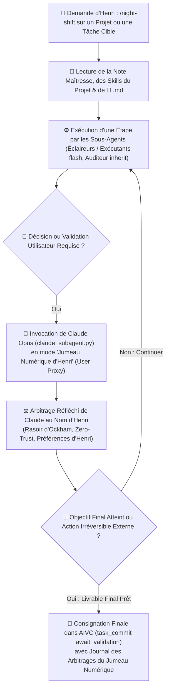

# 🌙 Comment Fonctionne le Skill `/night-shift` (Supervision Autonome Ciblée avec Claude Opus en Jumeau Numérique d'Henri) ?

Ce skill répond au besoin d'Henri lorsqu'il souhaite laisser Antigravity faire avancer **en totale autonomie un projet ou une tâche précise** (par exemple avant d'aller dormir, ou pendant plusieurs heures sur un chantier de recherche, d'écriture ou de code) **sans rester bloqué sur un statut `await_validation` intermédiaire**, tout en laissant intacts le fonctionnement standard d'**AIVC** et de **`project-memory`** pour le reste du portefeuille.



---

## 1. 🎯 Quand Activer `/night-shift` et Quelle Est sa Frontière Stricte ?

- **Déclenchement exclusif sur demande expresse d'Henri** : Ce skill ne s'active que lorsqu'Henri demande explicitement de superviser en autonomie un projet ou une tâche donnée (ex. *« Lance `/night-shift` sur ce papier pendant que je dors »*, *« Travaille en autonomie sur cette tâche et prends les décisions à ma place »*).
- **Confinement strict au projet ou à la tâche désignée** : Le Jumeau Numérique (Claude Opus) est habilité à trancher et valider les étapes intermédiaires **uniquement sur le projet ou la tâche expressément désignés par Henri**. Il n'a **jamais** le droit de toucher ni de valider les `await_validation` des autres projets du coffre.
- **Préservation d'AIVC et de `project-memory`** : En dehors d'une session `/night-shift`, toutes les tâches (y compris `is_recurring=True` comme les Échecs ou eMush en journée) conservent leur comportement standard dans AIVC (`await_validation` bloquant jusqu'à la décision d'Henri).

---

## 2. 🧠 Comment Invoquer Claude Opus (`claude_subagent.py`) en Tant que « Jumeau Numérique d'Henri » (*User Proxy*) ?

Chaque fois que le Superviseur ($P=0$) atteint un carrefour décisionnel sur le projet ciblé (choix d'architecture, arbitrage entre deux pistes expérimentales, critique d'un brouillon, validation d'une étape intermédiaire pour enchaîner la suivante), il **ne s'arrête pas** et **ne tranche pas seul en chambre d'écho Gemini** : il consulte **Claude Code (`opus`, effort `medium`)** via [`claude_subagent.py`](file:///c:/Users/Jamet/Documents/VoiceNotes/_agents/scripts-for-skills/claude_subagent.py) (`WaitMsBeforeAsync=500`).

### Contenu obligatoire du brief envoyé à Claude (`brief_proxy_henri_<sujet>.md`) :
1. **Clé projet en ligne 1** : `Projet : <chemin absolu de la note maîtresse .md>`
2. **Mandat explicite de Jumeau Numérique d'Henri Jamet** :
   - Demander à Claude d'incarner **Henri Jamet** (chercheur doctorant UNIL HEC / DESI, adepte du **Fail-Fast**, du **Rasoir d'Ockham**, de la **doctrine Zero-Trust**, allergique au jargon IA verbeux, aux usines à gaz, aux valeurs en dur et aux compromis mous).
   - Lui fournir les chemins vers :
     - La note maîtresse du projet et ses `## Skills` associés (`skills/<nom>.md`) ;
     - Les règles d'or d'Henri (`_agents/rules/zero-trust.md`, `_agents/rules/bonnes-pratiques-developpement.md`, `_agents/memory/memoire_principale.md`) ;
     - Les preuves brutes de l'étape qui vient de s'achever (`sources_executant.md`, `sources_audit.md`, métriques, PDF ou diff).
3. **Questions d'arbitrage posées au Jumeau Numérique** :
   - *« En te mettant rigoureusement à la place d'Henri Jamet, prends le temps de réfléchir en profondeur : (1) Qu'est-ce qui ne te convainc pas ou manque de rigueur dans ce livrable intermédiaire ? (2) Quelle option choisit Henri parmi les pistes A / B / C et pourquoi ? (3) Quelle est la prochaine instruction exacte à exécuter maintenant ? »*

### Commande d'invocation par le Superviseur :
```powershell
python "$env:USERPROFILE\Documents\VoiceNotes\_agents\scripts-for-skills\claude_subagent.py" --prompt-file "C:\Users\Jamet\.gemini\antigravity\brain\<conv-id>\brief_proxy_henri_<sujet>.md" --cwd "c:\Users\Jamet\Documents\VoiceNotes" --mode plan --artefact "C:\Users\Jamet\.gemini\antigravity\brain\<conv-id>\scratch\sources_claude_proxy.md"
```

---

## 3. 🛡️ Garde-Fous Absolus (Ce que même le Jumeau Numérique ne peut JAMAIS autoriser)

Conformément à [`zero-trust.md`](file:///c:/Users/Jamet/Documents/VoiceNotes/_agents/rules/zero-trust.md) et [`web-playwright.md`](file:///c:/Users/Jamet/Documents/VoiceNotes/_agents/rules/web-playwright.md), le mode `/night-shift` s'arrête devant toute **action externe irréversible** :
1. **Zéro envoi de courriel ou de message à un tiers réel** (Spark, Slack, Teams, Moodle, portail de soumission d'article SNAPP/OpenReview) : préparer tous les `/draft` et les PDF compilés prêts à envoyer, mais laisser le clic final d'envoi à Henri à son réveil.
2. **Zéro transaction financière ou démarche administrative finale**.
3. **Zéro suppression de données non versionnées**.

---

## 4. 📌 Consignation au Fil de l'Eau et Atterrissage dans AIVC (`await_validation` Cumulatif)

- À chaque jalon franchi pendant la nuit, le Superviseur met à jour la tâche du projet dans AIVC (`task_status="await_validation"`, sur le même `task_id`) **en mode cumulatif (sans jamais écraser les livrables ou `/draft` précédents non encore lus par Henri)**.
- Au réveil d'Henri, `🤖 <Titre>.md` présente un résumé limpide en phrases courtes de tout ce qui a été accompli pendant la nuit, les arbitrages pris par Claude Opus en tant que Jumeau Numérique, et les 1 ou 2 liens directs vers les livrables finaux prêts.
