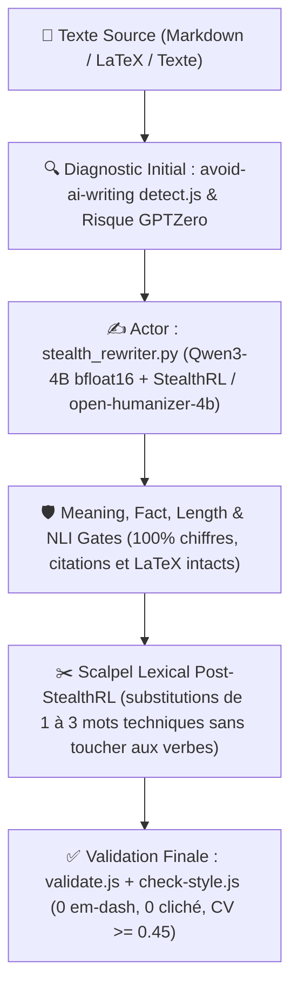

# 🛡️ Comment Reformulate-Human et stealth_rewriter.py Éradiquent-ils les Empreintes IA sans Altérer le Sens ?

Ce skill fournit un **moteur local autonome haute précision** d'humanisation textuelle et de contrôle anti-détection IA, propulsé par [stealth_rewriter.py](file:///c:/Users/hjamet/Documents/VoiceNotes/_agents/scripts-for-skills/stealth_rewriter.py) (`Qwen/Qwen3-4B-Instruct-2507` + adaptateurs `suraj-ranganath/StealthRL` GRPO et `akhaliq/open-humanizer-4b` SFT en `bfloat16` natif) et la suite déterministe [avoid-ai-writing](file:///c:/Users/hjamet/Documents/VoiceNotes/_agents/scripts-for-skills/avoid-ai-writing/).

---

## ⚡ Pourquoi ce Skill Est-il Centré sur `stealth_rewriter.py` (`bfloat16`) et `avoid-ai-writing` (Zéro Encodeur RoBERTa/DeBERTa, Zéro Flag `--fast`) ?

1. **Supériorité prouvée du RL adversaire (`StealthRL` GRPO + `open-humanizer-4b` SFT sur `Qwen3-4B` en `bfloat16` natif)** :
   - `suraj-ranganath/StealthRL` (`arXiv:2602.08934`) entraîne la politique de paraphrase par GRPO contre un comité de détecteurs (`97,6 %` à `99,9 %` d'évasion à $1\,\%$ FPR), tandis que `akhaliq/open-humanizer-4b` apporte la fluidité éditoriale humaine SFT (`r=32, \alpha=64`).
   - L'inférence en **`bfloat16` natif** (activée dès $\ge 7,5\text{ GiB}$ de VRAM, compatible RTX 2000 Ada 8 Go comme RTX 3060 12 Go) évite toute dégradation de quantification 4-bit NF4 sur les poids LoRA.
   - Le script vérifie automatiquement à chaque lancement via l'API Hugging Face si une nouvelle release des adaptateurs a été publiée et la télécharge le cas échéant.
2. **Suppression définitive des 5 encodeurs RoBERTa/DeBERTa et du flag `--fast`** :
   - Les petits classifieurs supervisés (`DeBERTa`, `ModernBERT`, `RoBERTa`) souffrent de la *RoBERTa AUROC anomaly* (`arXiv:2602.08934`, Section 5.3), prennent plus de 150 s sur CPU et sont décorrélés de GPTZero `4.1o`.
   - Tout flag de contournement (`--fast`, `--allow-partial`) est banni : la vérification repose sur les **Meaning/Fact Gates**, le score structurel instantané (`compute_gptzero_risk_score` : burstiness $\text{CV} \ge 0,45$, zéro clause participiale finale `, -ing...`, zéro tiret cadratin, $< 1\text{ ms}$) et la suite déterministe `avoid-ai-writing` (`detect.js`, `validate.js`, `check-style.js`, $< 0,5\text{ s}$ sur un article complet).

---

## 🔄 Comment Fonctionne la Boucle Fermée d'Humanisation ?



### 1. ✍️ Actor : Moteur GPU Natif [stealth_rewriter.py](file:///c:/Users/hjamet/Documents/VoiceNotes/_agents/scripts-for-skills/stealth_rewriter.py) (`StealthRL` `bfloat16`)
- **Pourquoi l'Agent LLM (Claude/Gemini) ne doit JAMAIS réécrire librement les phrases lui-même** : toute phrase réécrite librement par un modèle RLHF porte une signature de perplexité/burstiness détectée à `100 % AI` par GPTZero `4.1o`.
- **Étape 1a — Paraphrase GRPO/SFT par [stealth_rewriter.py](file:///c:/Users/hjamet/Documents/VoiceNotes/_agents/scripts-for-skills/stealth_rewriter.py) (appel unique sans flag)** :
  ```powershell
  python "c:\Users\hjamet\Documents\VoiceNotes\_agents\scripts-for-skills\stealth_rewriter.py" "<texte_ou_fichier>"
  ```
- **Étape 1b — Scalpel Lexical Post-StealthRL (restauration de la précision académique)** : sur la sortie brute de `StealthRL`, l'agent n'opère **que des remplacements lexicaux ciblés de 1 à 3 mots** pour restaurer la terminologie technique exacte que le modèle 4B aurait simplifiée (ex. acronymes, noms de modèles statistiques, `Cohort 1/2`), **sans toucher à la structure syntaxique ni aux verbes produits par `StealthRL`**.

### 2. 🛡️ Meaning & Fact Gates + Validation Déterministe (`< 0,5 s`)
- **Préservation Factuelle** : Maintien strict des chiffres, dates, métriques, énumérations `(1) (2) (3)` et entités nommées.
- **Contrôle Déterministe Obligatoire** :
  ```powershell
  node "c:\Users\hjamet\Documents\VoiceNotes\_agents\scripts-for-skills\avoid-ai-writing\skills\ai-writing-detector\scripts\detect.js" --file "<fichier>" --context technical
  node "c:\Users\hjamet\Documents\VoiceNotes\_agents\scripts-for-skills\avoid-ai-writing\detector\validate.js" "<avant>" "<apres>"
  node "c:\Users\hjamet\Documents\VoiceNotes\_agents\scripts-for-skills\avoid-ai-writing\scripts\check-style.js" "<apres>" --config technical
  ```
