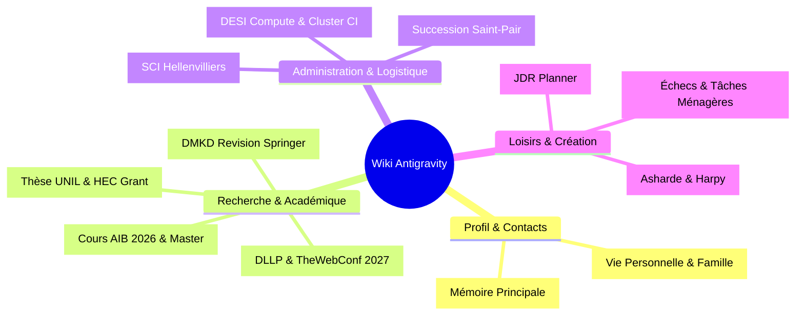

# 🧭 Index du Wiki d'Antigravity

Bienvenue dans le centre de connaissances d'Antigravity pour Henri Jamet. Ce fichier cartographie les grandes thématiques et notes maîtresses du coffre Obsidian (`c:\Users\Jamet\Documents\VoiceNotes` / `c:\Users\hjamet\Documents\VoiceNotes`).

## 🗂️ Catégories de Connaissances

### 👤 1. Mémoire Active & Gouvernance
* **Mémoire Principale (Court & Moyen Terme)** : [memoire_principale.md](file:///c:/Users/Jamet/Documents/VoiceNotes/_agents/memory/memoire_principale.md) — Profil d'Henri, invariants doctoraux, état temps réel des chantiers prioritaires et échéances futures.
* **Cockpit Obsidian** : [Home.md](file:///c:/Users/Jamet/Documents/VoiceNotes/Home.md) — Tableau de bord visuel à la racine du coffre.
* **Système Multi-Agent & Skills (`_agents/skills/` globaux & `skills/` intra-projet)** : [Améliorer le système Antigravity Obsidian.md](file:///c:/Users/Jamet/Documents/VoiceNotes/notes/Am%C3%A9liorer%20le%20syst%C3%A8me%20Antigravity%20Obsidian.md) · [Cout Antigravity et Comparaison Flash vs Argon.md](file:///c:/Users/hjamet/Documents/VoiceNotes/notes/Cout%20Antigravity%20et%20Comparaison%20Flash%20vs%20Argon.md) · [🤖 Consolidation et Exploration Dream.md](file:///c:/Users/Jamet/Documents/VoiceNotes/notes/%F0%9F%A4%96%20Consolidation%20et%20Exploration%20Dream.md) · [AIVC.md](file:///c:/Users/Jamet/Documents/VoiceNotes/AIVC.md) (Outil MCP interne & Pont Gemini Audio `Dream_Inbox` / `Live_*`).

### 🔬 2. Recherche & Enseignement (UNIL / HEC Lausanne / DESI)
* **Plateforme DLLP & TheWebConf 2027 (Soumission `#7201`)** : [Digital Language Learning Platform.md](file:///c:/Users/Jamet/Documents/VoiceNotes/notes/Digital%20Language%20Learning%20Platform.md) · [Pré-publication OSF DLLP.md](file:///c:/Users/Jamet/Documents/VoiceNotes/Pr%C3%A9-publication%20OSF%20DLLP.md)
* **Révision Majeure DMKD (Springer Nature `#60f781a2`)** : [Difficulty Estimation Simplification and Recommendation DMKD.md](file:///c:/Users/Jamet/Documents/VoiceNotes/notes/Difficulty%20Estimation%20Simplification%20and%20Recommendation%20DMKD.md)
* **Statut de Thèse, Subventions & Prépublications ArXiv** : [Statut et Calendrier de These Doctorat UNIL.md](file:///c:/Users/Jamet/Documents/VoiceNotes/notes/Statut%20et%20Calendrier%20de%20These%20Doctorat%20UNIL.md) · [Obligations Departementales et Seminaires DESI UNIL.md](file:///c:/Users/Jamet/Documents/VoiceNotes/notes/Obligations%20Departementales%20et%20Seminaires%20DESI%20UNIL.md) · [Candidature HEC Research Grant 2026 2027.md](file:///c:/Users/Jamet/Documents/VoiceNotes/notes/Candidature%20HEC%20Research%20Grant%202026%202027.md) · [Soumission ArXiv Pipeline Articles.md](file:///c:/Users/Jamet/Documents/VoiceNotes/notes/Soumission%20ArXiv%20Pipeline%20Articles.md) · [CV Site Web et LinkedIn Henri Jamet.md](file:///c:/Users/hjamet/Documents/VoiceNotes/notes/CV%20Site%20Web%20et%20LinkedIn%20Henri%20Jamet.md) · [Mise à jour de mes contenus en ligne.md](file:///c:/Users/hjamet/Documents/VoiceNotes/notes/Mise%20%C3%A0%20jour%20de%20mes%20contenus%20en%20ligne.md)
* **Enseignement AIB 2026 & Supervisions Master** : [Organisation du cours Artificial Intelligence in Business 2026.md](file:///c:/Users/Jamet/Documents/VoiceNotes/Organisation%20du%20cours%20Artificial%20Intelligence%20in%20Business%202026.md) · [Master Supervision.md](file:///c:/Users/Jamet/Documents/VoiceNotes/notes/Master%20Supervision.md)
* **Projets Soumis & Bancs d'Essai Autoresearch (`/advance`)** : [LLM as a Recommender.md](file:///c:/Users/Jamet/Documents/VoiceNotes/notes/LLM%20as%20a%20Recommender.md) (ECIR 2027 `#512` soumis / extension Fast Journal) · [Jeu Educatif LLM AAAI EAAI.md](file:///c:/Users/Jamet/Documents/VoiceNotes/notes/Jeu%20Educatif%20LLM%20AAAI%20EAAI.md) (`LATENT SPACE`) · [Survey IA et Apprentissage des Langues.md](file:///c:/Users/Jamet/Documents/VoiceNotes/notes/Survey%20IA%20et%20Apprentissage%20des%20Langues.md) (Banc d'essai d'écriture autonome `/advance` + Autoresearch) · [Projet Orbit.md](file:///c:/Users/Jamet/Documents/VoiceNotes/notes/Projet%20Orbit.md) (Banc d'essai GSET/CLIMB & ORBIT `karpathy/autoresearch` sur `UNIL-DESI` + `Cluster CI`) · [Obfuscation Stylistique Personnelle par VoiceNotes et GRPO.md](file:///c:/Users/Jamet/Documents/VoiceNotes/notes/Obfuscation%20Stylistique%20Personnelle%20par%20VoiceNotes%20et%20GRPO.md) (Idée d'article & pipeline `Cluster CI --local` d'alignement stylistique sur les 2 087 `voicenotes/` + GRPO de courbure).

### 💼 3. Administration, Patrimoine Familial & Vie Quotidienne
* **SCI Hellenvilliers (Domaine familial d'Épinay)** : [Gestion de la SCI Hellenvilliers.md](file:///c:/Users/Jamet/Documents/VoiceNotes/notes/Gestion%20de%20la%20SCI%20Hellenvilliers.md)
* **Succession Saint-Pair** : [Succession Saint-Pair.md](file:///c:/Users/Jamet/Documents/VoiceNotes/notes/Succession%20Saint-Pair.md)
* **Infrastructure GPU DESI & Cluster CI** : [DESI Compute.md](file:///c:/Users/Jamet/Documents/VoiceNotes/notes/DESI%20Compute.md) · [Cluster CI.md](file:///c:/Users/Jamet/Documents/VoiceNotes/notes/Cluster%20CI.md) · [Publication Cluster CI et Architecture Antigravity.md](file:///c:/Users/Jamet/Documents/VoiceNotes/notes/Publication%20Cluster%20CI%20et%20Architecture%20Antigravity.md)
* **Démarches Associatives, Bancaires & Maison** : [Refonte du site WordPress de SEM.md](file:///c:/Users/Jamet/Documents/VoiceNotes/notes/Refonte%20du%20site%20WordPress%20de%20SEM.md) · [Tâches Ménagères.md](file:///c:/Users/Jamet/Documents/VoiceNotes/T%C3%A2ches%20M%C3%A9nag%C3%A8res.md) (App Android Timer & Tags avec Annabelle) · [Clôture Banque Postale et Vivaccio.md](file:///c:/Users/Jamet/Documents/VoiceNotes/notes/Cl%C3%B4ture%20Banque%20Postale%20et%20Vivaccio.md)

### 🎲 4. Création, Jeux de Rôle, Échecs & Développement
* **Écosystème JDR & Harpy** : [JDR Planner.md](file:///c:/Users/Jamet/Documents/VoiceNotes/notes/JDR%20Planner.md) · [Asharde.md](file:///c:/Users/Jamet/Documents/VoiceNotes/notes/Asharde.md) · [Harpy Chrome Extension.md](file:///c:/Users/Jamet/Documents/VoiceNotes/notes/Harpy%20Chrome%20Extension.md) · [Application Asharde.md](file:///c:/Users/Jamet/Documents/VoiceNotes/notes/Application%20Asharde.md)
* **Campagnes & Chroniques** : [Le Conseil des Voleurs.md](file:///c:/Users/Jamet/Documents/VoiceNotes/notes/Le%20Conseil%20des%20Voleurs.md) (Pathfinder PF1e) · [Chronique Harpy Shan Ning.md](file:///c:/Users/Jamet/Documents/VoiceNotes/notes/Chronique%20Harpy%20Shan%20Ning.md) (Vampire V5)
* **Jeux de Société, Échecs & IA MCTS** : [Pourquoi je perds aux échecs.md](file:///c:/Users/Jamet/Documents/VoiceNotes/Pourquoi%20je%20perds%20aux%20%C3%A9checs.md) (`chess-tutor` : Coach Lichess + Stockfish 18 + Maia 3 + VoiceNotes) · [Mazic.md](file:///c:/Users/hjamet/Documents/VoiceNotes/notes/Mazic.md) (Roguelike horrifique multijoueur Web/FastAPI & Voice Proximity) · [Créer le programme pour gagner au Scrabble pour Enzo et Loïc avec Nicolas.md](file:///c:/Users/hjamet/Documents/VoiceNotes/notes/Cr%C3%A9er%20le%20programme%20pour%20gagner%20au%20Scrabble%20pour%20Enzo%20et%20Lo%C3%AFc%20avec%20Nicolas.md) (`scrabble-enzo` ODS8) · [eMush Survie et Enquete sur le Daedalus.md](file:///c:/Users/Jamet/Documents/VoiceNotes/notes/eMush%20Survie%20et%20Enquete%20sur%20le%20Daedalus.md) (Survie spatiale & Chronique romancée EternalTwin avec Frieda Bergmann — Sous-index modulaire : [index_emush.md](file:///c:/Users/hjamet/Documents/VoiceNotes/_agents/memory/index_emush.md)) · [Frontier.md](file:///c:/Users/Jamet/Documents/VoiceNotes/notes/Frontier.md) · [Création de Jeu de Société.md](file:///c:/Users/Jamet/Documents/VoiceNotes/notes/Cr%C3%A9ation%20de%20Jeu%20de%20Soci%C3%A9t%C3%A9.md) (`Créatures` : Grille 5×5 & Deckbuilding `board-games/creatures`) · [Mush Sabotage et Contamination Spatiale.md](file:///c:/Users/Jamet/Documents/VoiceNotes/notes/Mush%20Sabotage%20et%20Contamination%20Spatiale.md) (`Mush` : Piles LIFO 15 min `board-games/mush`) · [Fantasy Realms.md](file:///c:/Users/Jamet/Documents/VoiceNotes/notes/Fantasy%20Realms.md) · [Améliorer le programme qui gagne tout le temps au Chibre pour massacrer Vichoud.md](file:///c:/Users/Jamet/Documents/VoiceNotes/notes/Am%C3%A9liorer%20le%20programme%20qui%20gagne%20tout%20le%20temps%20au%20Chibre%20pour%20massacrer%20Vichoud.md)
