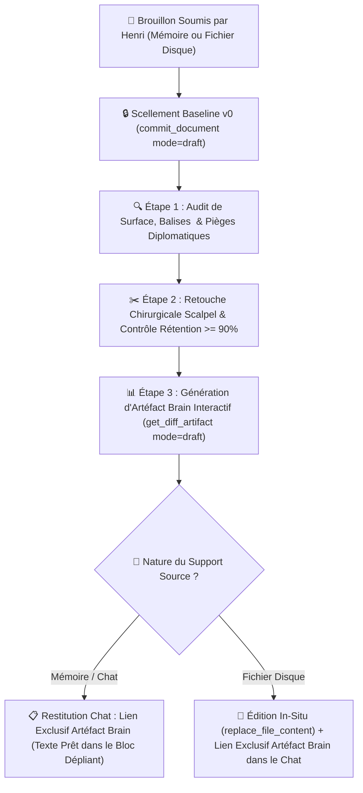
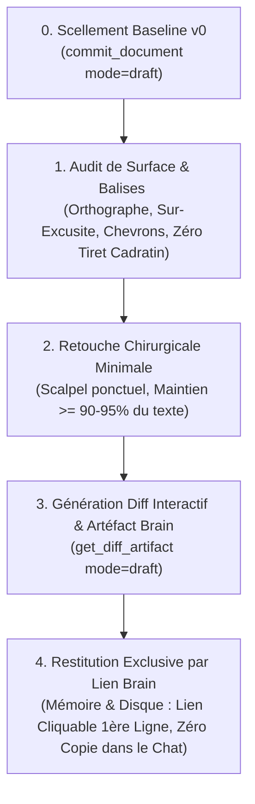

# ✍️ Comment le Skill /draft Assure-t-il la Relecture, la Complétion et la Retouche Chirurgicale sans Altérer la Voix d'Henri ?

Ce skill formalise le **protocole obligatoire de rédaction, relecture, correction et retouche chirurgicale** de **tout texte destiné à un humain particulier ou visant à être publié en ligne** (courriels, messages Moodle/Slack/Teams, lettres aux éditeurs/reviewers, prose de papiers de recherche, documents officiels, mais aussi **pages et notes publiques Obsidian Publish / `henri-jamet.com`, articles de blog, billets LinkedIn/Medium, profils et `README.md` publics GitHub `hjamet/hjamet`**) pour **Henri Jamet**. Dès qu'un agent (en session interactive, `/one-shot` ou en autonomie `/advance`) doit rédiger, modifier ou polir un texte adressé à un humain ou destiné à être publié, il **DOIT obligatoirement passer par `/draft`** (et conjointement par [`/email-style`](file:///c:/Users/hjamet/Documents/VoiceNotes/_agents/skills/email-style/SKILL.md) pour tout courriel ou message, ou le skill de projet [`skills/redaction_papier_scientifique.md`](file:///c:/Users/hjamet/Documents/VoiceNotes/skills/redaction_papier_scientifique.md) pour un manuscrit académique). **Garde-fou de publication en 2 temps** : l'agent génère d'abord l'artéfact interactif `/draft` (`_agents/project_diffs/🤖 <Nom>.md`) pour relecture par Henri, et ne procède à la mise en ligne ou publication effective qu'une fois qu'Henri a explicitement validé le texte (*« OK, publie-le »*). Il garantit une élimination sans faille des coquilles et des maladresses institutionnelles tout en érigeant un rempart infranchissable contre la dérive « LLM-like » et la réécriture intégrale courante des LLM.



---

## 0. 🎯 Quelle Est la Règle Canonique de Restitution Arbitrée par Henri ?

> [!IMPORTANT]
> **RÈGLE FORMELLE D'ARBITRAGE DE RESTITUTION D'HENRI :**
> - **Génération Systématique d'un Artéfact Unifié par Cible dans `_agents/project_diffs/🤖 <Nom>.md` (`1 cible = 1 artéfact 🤖 <Nom>.md` qui s'écrase lui-même)** : Quel que soit le support source (note Obsidian, fichier externe `code/<repo>/<fichier>` ou message flottant `virtual:<Sujet>`), un artéfact interactif Markdown dédié (`file:///c:/Users/hjamet/Documents/VoiceNotes/_agents/project_diffs/🤖%20<Nom>.md`) est **TOUJOURS généré et écrasé sur place** via l'outil MCP `get_diff_artifact(mode="draft")` en comparant l'état actuel à la dernière baseline validée par Henri (`author="henri"`), avec conversion automatique des `[[wikilinks]]` en liens cliquables Antigravity, contrôle de rétention ($\ge 90\%$), tableau de traçabilité complet et copie en 1 clic depuis `<details><summary>📋 Texte Final Prêt à Copier</summary>`. **Interdiction absolue de regrouper plusieurs courriels/messages dans un même fichier ou de fabriquer un fichier de diff à la main via `write_to_file`.**
> - **Restitution Exclusive par Lien vers l'Artéfact Brain (Zéro Pollution Textuelle dans le Chat)** :
>   Quelle que soit la source (mémoire ou fichier disque), la restitution dans le chat consiste **EXCLUSIVEMENT** à partager en première ligne le **lien cliquable vers l'artéfact interactif** (`file:///c:/Users/hjamet/Documents/VoiceNotes/_agents/project_diffs/🤖%20<Nom>.md`) généré par la machine (`get_diff_artifact`).
>   * **Justification** : Cela permet à Henri d'inspecter le diff, de laisser des commentaires ciblés directement via l'interface d'artéfact, et de copier le texte propre depuis le bloc natif `<details><summary>📋 Texte Final Prêt à Copier</summary>`. Zéro pollution textuelle dans le fil de discussion.
>   * **Suppression de l'Affichage Intégral dans le Chat** : Interdiction formelle d'afficher le texte rédigé intégralement dans le fil de discussion Antigravity (même pour les textes soumis en mémoire).
> - **Déclinaison selon le Support Source** :
>   1. **Texte Soumis en Mémoire Pure (Chat sans Fichier Disque)** :
>      * Génération de l'artéfact virtuel (`virtual:draft_message` ➔ `virtual_draft_*.md`) avec son bloc natif `<details><summary>📋 Texte Final Prêt à Copier</summary>`.
>      * Restitution dans le fil de discussion Antigravity **EXCLUSIVEMENT du lien cliquable en première ligne** vers cet artéfact interactif.
>   2. **Texte Issu d'un Fichier Existant sur le Disque (Note Obsidian, Document, etc.)** :
>      * Modification chirurgicale **in-situ** du fichier cible via `replace_file_content` (zéro réécriture complète).
>      * Restitution dans le fil de discussion Antigravity **EXCLUSIVEMENT DU LIEN CLIQUABLE** vers l'artéfact (`file:///c:/Users/hjamet/Documents/VoiceNotes/_agents/project_diffs/🤖%20<Nom>.md`) en première ligne.
>      * **INTERDICTION FORMELLE DE COPIE INTÉGRALE** : Ne jamais recopier le texte entier du fichier dans le fil de discussion.
> - **🌐 Interopérabilité dès la Phase de Planification (`/plan`)** :
>   Lorsqu'Henri demande de rédiger ou polir un texte avant ou pendant la formalisation d'un plan d'implémentation (`implementation_plan.md`), l'instrumentation machine de `/draft` s'exécute **immédiatement**. L'artéfact `diff_*.md` est généré dans le brain de l'agent actif et soumis à l'arbitrage d'Henri, garantissant que tout texte humain soit rigoureusement audité et validé avant l'exécution.

---

## 🎯 Quelle Est la Philosophie et la Raison d'Être du Skill /draft ?

### 🛡️ Pourquoi Sanctuariser la Voix et l'Authenticité d'Henri ?
- **Respect du temps et de l'énergie** : Henri sait exactement ce qu'il veut dire, à qui il s'adresse et quel impact il vise. Le rôle de l'assistant n'est pas de réinventer sa pensée, mais de polir ses mots avec le tranchant d'un scalpel.
- **Préservation de l'authenticité** : La force de conviction d'Henri réside dans son ton direct, incarné, humain, percutant et sincère. Tout lissage aseptisé détruit cette signature personnelle et dépersonnalise ses échanges.
- **Rejet de la complaisance IA (Sycophancy & Corpo-Wash)** : Les modèles de langage ont un biais systématique les poussant à substituer un texte personnel par un jargon d'entreprise impersonnel, verbeux et artificiellement obséquieux (*"I hope this email finds you well"*, *"Permettez-moi de revenir vers vous..."*, *"N'hésitez pas si vous avez des questions"*). Le skill `/draft` agit comme un antidote strict à ce réflexe.

| Dimension | Voix Authentique d'Henri | Dérive IA / Corpo-Wash (Bannie) |
| :--- | :--- | :--- |
| **Attaque** | Directe, va droit au but dès la 1ère phrase | Préambules creux et salutations boursouflées |
| **Structure (Courriels & Messages)** | **Paragraphes continus fluides** (1 à 3 paragraphes courts), zéro gras Markdown, smileys textuels naturels (`:)`, `:D`, `^^`) — cf. [`email-style`](file:///c:/Users/hjamet/Documents/VoiceNotes/_agents/skills/email-style/SKILL.md) | Listes à puces ou numérotées avec titres en gras (`1. **Titre** : ...`), sous-titres artificiels, émojis Unicode |
| **Ton** | Concret, vif, dynamique, accessible, chaleureux | Formel, pompeux, distancé, passif |
| **Vocabulaire** | Mots justes, précis, simples et efficaces | Superlatifs automatiques, jargon administratif lourd |
| **Posture** | Égale, confiante, orientée solution et action | Auto-dépréciative, sur-excusite, hésitation |
| **Rythme** | Phrases courtes et enchaînements naturels | Périodes longues alourdies de propositions subordonnées |

> [!IMPORTANT]
> **COURRIELS (SPARK) & MESSAGES (MOODLE, TEAMS, SLACK)** : Lorsqu'il s'agit de rédiger ou de retoucher un courriel ou un message, l'agent **DOIT** lire et appliquer conjointement la charte [`email-style/SKILL.md`](file:///c:/Users/hjamet/Documents/VoiceNotes/_agents/skills/email-style/SKILL.md) (ligne d'objet `Subject: ...` / `Objet : ...` systématique en tête de tout courriel, paragraphes continus courts $\le 6\text{–}8$ lignes sans listes à titres en gras ni déballage de métriques, formules d'appel et de clôture calibrées selon l'interlocuteur).

---

## 🛑 Quelle Est la Règle d'Or : Fidélité aux Formulations Principales & Élagage des Répétitions ?

> [!IMPORTANT]
> **RÈGLE D'OR : PRÉSERVER LES FORMULATIONS PRINCIPALES D'HENRI TOUT EN ÉLIMINANT LES RÉPÉTITIONS ET EN STRUCTURANT LE PROPOS.**
> - **Ancrage dans les formulations d'Henri** : Toujours rester très proche des tournures clés, du vocabulaire, de l'énergie et des images choisis par Henri. Interdiction absolue de substituer un jargon générique ou corporatif ("corpo-wash") à ses mots.
> - **Distinction Brouillon Écrit vs Transcript Oral Dicté** :
>   * **Brouillon écrit déjà structuré** : Principe de subsidiarité chirurgicale ($\ge 90\%$ de préservation mot à mot). Si une phrase écrite est correcte, fluide et sans piège diplomatique, on ne la réécrit pas.
>   * **Transcript oral ou dictée à la volée** *(décision d'Henri, 19/10/2026)* : À l'oral, la pensée se construit en marchant et comporte naturellement des redites. L'agent **doit** supprimer sans hésiter les répétitions (ex. un même syntagme répété 3 ou 4 fois), condenser les longueurs et **réorganiser l'ordre des idées** pour regrouper logiquement les arguments en paragraphes continus percutants, tout en conservant les formulations principales d'Henri. Lors du scellement CAS (`commit_document`), la baseline `v0` scelle la version déjà condensée/structurée afin que le diff interactif `get_diff_artifact` conserve un taux de rétention $\ge 90\%$ centré sur le polissage lexical fin.
> - **Bannissement du "mieux disant" subjectif & Zéro paraphrase du message reçu** *(directive d'Henri, 29/10/2026)* : Hors élagage des répétitions orales et regroupement logique, ne jamais remplacer un mot précis d'Henri par un synonyme arbitraire. Lors de la rédaction d'une réponse à un courriel ou message, **ne jamais écrire plusieurs lignes pour répéter ou paraphraser ce qu'a dit l'interlocuteur** : chaque phrase doit apporter une information nouvelle, sans jamais se répéter.

> [!CAUTION]
> **🚫 INTERDICTION FORMELLE DE FICHIER INTERMÉDIAIRE OU DE TRANSCRIPTION SCRATCH :**
> - Lorsque le texte source réside dans un fichier existant sur le disque (qu'il s'agisse de Markdown `.md`, de LaTeX `.tex`, de Typst `.typ`, ou de code), l'agent a l'**INTERDICTION FORMELLE ET ABSOLUE** de créer un fichier de travail intermédiaire, un brouillon scratch ou une extraction textuelle manuelle (ex: créer un `.md` temporaire pour "enlever les balises LaTeX").
> - Les outils machine `doc-version` (`commit_document` et `get_diff_artifact`) opèrent **DIRECTEMENT ET EXCLUSIVEMENT sur le fichier source d'autorité sur le disque** (ex: `main.tex`).
> - C'est l'artéfact de diff généré automatiquement par la machine qui expose nativement le texte final prêt à copier dans son bloc dépliant `<details><summary>📋 Texte Final Prêt à Copier</summary>`.
> - Toute création de fichier intermédiaire constitue une falsification et une violation critique de l'exclusivité machine de `/draft`.

---

## 🧭 Quel Est le Protocole d'Exécution Instrumenté par doc-version-mcp ?

Le cycle `/draft` s'articule autour du versioning déclaratif CAS pour garantir l'intégrité de la voix d'Henri et la traçabilité intégrale des retouches :

> [!IMPORTANT]
> **Double Voie d'Exécution (MCP doc-version ou CLI doc_version_cli.py)** :
> 1. **Voie Principale (MCP)** : Appel direct des outils `doc-version` (`commit_document`, `get_diff_artifact`).
> 2. **Voie Robuste (CLI Local)** : Si le serveur MCP est inactif, exécuter impérativement le script Python dédié en chemin absolu adapté à la machine :
>    `& "<chemin_absolu>\code\doc-version-mcp\.venv\Scripts\python.exe" "<chemin_absolu>\VoiceNotes\_agents\scripts-for-skills\doc_version_cli.py" diff --target "<fichier>" --explanation "<motif>" --content-file "<fichier_retouche>" --brain-dir "<appDataDir>/brain/<id>" --artifact-name "<nom>.md"`
> **INTERDICTION STRICTE DE SIMULATION** : Il est formellement interdit de créer l'artéfact à la main avec `write_to_file`.



### 🔒 0. Comment Sceller la Baseline v0 Avant Toute Intervention ?

Avant de commencer la moindre retouche, l'état initial doit être sanctuarisé dans le cache CAS via `commit_document` :
- **Si le texte est soumis en mémoire (chat)** :
  ```python
  call_mcp_tool(
      ServerName="doc-version",
      ToolName="commit_document",
      Arguments={
          "target": "virtual:draft_message",
          "content": "<texte_brut_soumis_par_henri>",
          "message": "Baseline v0 brouillon",
          "author": "henri",
          "mode": "draft"
      }
  )
  ```
- **Si le texte réside dans un fichier existant sur disque** :
  ```python
  call_mcp_tool(
      ServerName="doc-version",
      ToolName="commit_document",
      Arguments={
          "target": "C:/Users/hjamet/Documents/.../fichier.md",
          "message": "Baseline v0 brouillon",
          "author": "henri",
          "mode": "draft"
      }
  )
  ```

---

### 🔍 1. Comment Réaliser l'Audit de Surface et Détecter les Pièges ?

L'analyse initiale scanne le texte sur deux plans complémentaires :

#### 📝 Comment Corriger Formellement l'Orthographe, la Typographie et les Accords ?
- **Orthographe & Typographie** : Coquilles, fautes de frappe, accents manquants, cédilles, apostrophes typographiques.
- **Accords & Syntaxe** : Accords sujet-verbe, participes passés, accords en genre et en nombre, cohérence des temps.
- **Ponctuation** : Virgules mal placées brisant le souffle, espaces insécables avant ponctuation double en français (`:`, `;`, `!`, `?`).

#### 🛡️ Comment Traquer la Sur-Excusite et les Formulations Négatives ?
- **Élimination de la sur-excusite (Over-apologizing)** :
  * ❌ *« Je suis sincèrement désolé de vous déranger avec cela... »* ➔ ✅ Supprimé ou remplacé par une formule d'action directe.
  * ❌ *« Excuse my English, I hope I'm clear... »* ➔ ✅ Supprimé purement et simplement.
  * ❌ *« Je m'excuse d'avance pour le retard de ma réponse... »* ➔ ✅ *« Merci pour ta patience ! »* ou traitement immédiat de la question.
- **Remplacement des mots négatifs ou défensifs non intentionnels** :
  * Transformer les formulations passives ou culpabilisantes en constat factuel et tourné vers l'avenir.
  * ❌ *« Il y a eu un problème / une erreur de ma part »* ➔ ✅ Constat factuel neutre : *« Le fichier n'était pas attaché, le voici : ... »*.
- **Éradication des marqueurs IA et tics académiques creux** :
  * Purge absolue des tirets cadratins (`—`) ou tirets d'incise (`–`) au profit de virgules, parenthèses sobres ou points.
  * Bannissement des adverbes d'enrobage (*"fondamentalement"*, *"naturellement"*, *"incontestablement"*).

---

## 🧩 Comment Résoudre Chirurgicalement les Balises d'Hésitation & Données Manquantes <XXX> ?

Lorsque Henri insère des balises délimitées par des chevrons `<...>` dans son texte brut :

### 1. Règle des Deux Typologies de Balises `<XXX>`
1. **Cas A — Hésitation Lexicale ou Synonyme** (ex: `<protocole>`, `<dispositif>`, `<amicalement>`) :
   - L'agent remplace la balise par le terme le plus naturel, précis et institutionnellement adapté au contexte.
   - Respect strict du registre relationnel et de la voix d'Henri, sans extrapolation ni jargon boursouflé.

2. **Cas B — Donnée Factuelle Manquante ou Indice Intégré** (ex: `<5h ? Mais un classique d'après l'UNIL>`, `<chiffre CA>`, `<date limite>`) :
   - **Prendre en compte les indices d'Henri** : Analyser les réflexions, approximations ou pistes textuelles fournies à l'intérieur des chevrons.
   - **Interdiction formelle d'inventer** : L'agent ne devine jamais une métrique au hasard. Il déclenche une recherche active (notes du coffre, syllabus, e-mails Spark, règlements officiels, MCPs) pour identifier la donnée exacte et sourcée.
   - **Substitution fluide** : Remplacer l'intégralité du tag `<XXX>` par la valeur vérifiée intégrée harmonieusement dans la phrase.

### 2. Traçabilité dans le Tableau de Diff
Toute résolution de balise `<XXX>` fait l'objet d'une ligne dédiée dans le tableau de diff :
| Balise Originale (Avant) | Remplacement Validé (Après) | Justification & Source Vérifiée |
| :--- | :--- | :--- |
| *`<protocole>`* | *« dispositif d'évaluation continue »* | Qualification juridique conforme au règlement RBHEC art. 10. |
| *`<5h ? Mais classique...>`* | *« environ 15 heures de préparation »* | Standard ECTS du cours AIB (soutenance de 30 min en équipe). |

---

### ✂️ 2. Comment Appliquer la Retouche Chirurgicale et l'Élagage des Redondances ?

- **Opérer au mot près sur les formulations clés** : Conserver les tournures signatures d'Henri et ne retoucher que le mot fautif, l'oralité brute ou la locution boiteuse.
- **Élaguer les répétitions et structurer les dictées orales** : Lorsque l'entrée est un transcript oral, fusionner les redites, condenser les périphrases et réorganiser les phrases pour que chaque idée ne soit exprimée qu'une seule fois de manière directe et limpide.
- **Audit de rétention $\ge 90\%$ sur la baseline structurée** : Vérifier que le ratio de préservation textuelle entre la baseline structurée `v0` et la version polie `v1` respecte le seuil contractuel ($\ge 90\%$).
- **Préserver le registre relationnel** :
  * Si Henri tutoie : conserver le tutoiement sans basculer au vouvoiement.
  * Si Henri utilise un smiley textuel (`:)`, `:D`, `^^`), le laisser exactement là où il l'a placé.
  * Ne jamais ajouter de formule de politesse pompeuse en fin de message si Henri a simplement signé *"Henri"* ou *"Joyeusement,"*.

### 🛡️ 2bis. Comment Réécrire en Mode Humain Indétectable (`stealth_rewriter.py` / Anti-GPTZero `4.1o`) ?

Lorsque `/draft` est sollicité pour produire, réécrire ou camoufler un passage initialement rédigé par un LLM (abstract scientifique, paragraphe d'article, texte généré de zéro) afin qu'il franchisse les détecteurs modernes (GPTZero `4.1o`, Turnitin, RAID) avec un verdict `HUMAN_ONLY` ($> 95\,\%$ Human) :
1. **Exécution obligatoire du moteur GPU natif Windows [stealth_rewriter.py](file:///c:/Users/hjamet/Documents/VoiceNotes/_agents/scripts-for-skills/stealth_rewriter.py)** (`Qwen/Qwen3-4B-Instruct-2507` + adaptateurs GRPO `suraj-ranganath/StealthRL` et `akhaliq/open-humanizer-4b` chargés automatiquement en **`bfloat16` natif** dès que la VRAM $\ge 7.5\text{ Go}$, sans dégradation 4-bit NF4, sans WSL2 et sans flag de contournement) :
   ```powershell
   python "c:\Users\hjamet\Documents\VoiceNotes\_agents\scripts-for-skills\stealth_rewriter.py" "<texte_ou_fichier>"
   ```
   *(Un seul appel sans flag : le script évalue chaque paragraphe via le proxy GPTZero perplexité + burstiness CV, réécrit en `bfloat16` les paragraphes détectables, vérifie l'équivalence sémantique NLI `DeBERTa-v3-large`, met à jour directement le fichier ou retourne le texte corrigé).*
2. **Interdiction absolue de réécriture libre par le LLM principal après `StealthRL`** : toute phrase entière réécrite ou « polie » librement par un grand modèle RLHF (Claude/Gemini) réintroduit instantanément la distribution de log-probabilités RLHF et fait bondir GPTZero `4.1o` à `100 % AI`.
3. **Protocole du « Scalpel Lexical Post-StealthRL » (Double Contrôle Qualité + Indétectabilité)** :
   - Partir **exclusivement** du texte brut produit par `StealthRL` (`bfloat16` natif, prompt GRPO canonique).
   - N'effectuer que des **substitutions lexicales ponctuelles de 1 à 3 mots** (*surgical noun-phrase swaps*) pour rétablir les termes techniques exacts du domaine que le modèle 4B aurait simplifiés ou généralisés (ex. rétablir `Cohort 1` / `Cohort 2`, `Personal Knowledge Graphs (PKGs)`, `Socratic Multi-Agent Systems (MAS)`, `Human-in-the-Loop (HITL)`, `1:1 teacher Digital Twins`), **en conservant intacte la charpente syntaxique et les verbes choisis par `StealthRL`**.
   - Zéro tiret cadratin (`—`) et zéro double tiret (`--`).

---

### 📊 3. Comment Générer l'Artéfact de Diff et Restituer les Résultats selon la Règle d'Henri ?

> [!CAUTION]
> **🚫 INTERDICTION FORMELLE DE FABRICATION OU RETOUCHE MANUELLE D'ARTÉFACT /DRAFT (IMMUABILITÉ STRICTE)** :
> 1. **Zéro Fabrication Manuelle** : Il est formellement interdit à l'agent de concevoir, rédiger ou simuler artisanalement un artéfact de diff interactif `/draft` via `write_to_file`.
> 2. **Immuabilité Machine Absolue** : Une fois généré par l'outil machine officiel (`doc-version` `get_diff_artifact` ou CLI dédiée), l'artéfact Markdown interactif (`diff_*.md`) est **STRICTEMENT IMMUABLE**. **INTERDICTION ABSOLUE de le retoucher ou modifier manuellement** (via `replace_file_content` ou `write_to_file`).
> 3. Tout artéfact rédigé ou altéré à la main est nul, non avenu, et constitue une violation critique du protocole /draft.

#### 🛠️ Génération de l'Artéfact Brain Interactif (`get_diff_artifact` — Sans Obfuscation Automatique `StealthRL`)
L'artéfact interactif Markdown est généré via le serveur MCP `doc-version` (`run_stealth=False` par défaut suite à la décision d'Henri du 29/10/2026, l'obfuscation générique `StealthRL` dégradant la qualité rédactionnelle à Likert `2.59/5` contre `4.03/5` selon `arXiv:2602.08934`) :
```python
call_mcp_tool(
    ServerName="doc-version",
    ToolName="get_diff_artifact",
    Arguments={
        "target": "virtual:draft_message",  # ou chemin absolu du fichier disque
        "content": "<texte_retouche_complet>",  # requis si virtuel
        "diff_explanation": "Polissage chirurgical, résolution balises <XXX>, élimination sur-excusite",
        "mode": "draft",
        "language": "fr",  # ou "auto" pour détection automatique du Style Guard (fr_ai_patterns)
        "brain_dir": "C:/Users/hjamet/.gemini/antigravity/brain/<conversation-id>"
    }
)
```
Cet artéfact intègre automatiquement les composantes suivantes :
- **📕 Lien Automatique vers le PDF Compilé en En-tête** : Dès qu'un PDF compilé est associé au fichier cible (même base `<stem>.pdf`, `main.pdf`, `paper.pdf` ou document maître via `\input{...}`) ou passé via `pdf_path`, `doc-version` copie le PDF dans `brain/<conversation-id>/` et affiche automatiquement `📕 **PDF Compilé** : [<nom>.pdf](file:///...)` dans l'en-tête de l'artefact `diff_*.md` pour permettre l'ouverture directe dans le visualiseur PDF natif d'Antigravity.
- **📋 Bloc Dépliant de Texte Final Prêt à Copier (Natif en Tête d'Artéfact)** : En mode `mode="draft"`, l'artéfact intègre nativement en tête de document (avant l'arborescence des diffs) le bloc dépliant suivant :
  ```markdown
  <details><summary>📋 Texte Final Prêt à Copier</summary>

  ```text
  <texte_final_poli_sans_balises>
  ```
  </details>

  ---
  ```
  Ce bloc permet à Henri ou à l'agent de récupérer le texte final intégral d'un simple clic pour un copier-coller immédiat sans friction, directement depuis l'artéfact.
- **🌳 Arborescence & Word-Diff AST Coloré** : Visualisation chirurgicale des ajouts (`<ins>`) et suppressions (`<del>`), badges pill de score Anti-IA paragraphe par paragraphe.
- **🕒 Historique Récent & Rétention** : Tableau des 5 derniers commits CAS et audit du taux de rétention ($\ge 90\%$).

#### 📋 Restitution Concrète selon le Support Source :

Quelle que soit la source (mémoire ou fichier disque), la restitution dans le fil de discussion Antigravity consiste **EXCLUSIVEMENT** à partager en première ligne le **lien cliquable vers l'artéfact Brain interactif** (`virtual_draft_*.md` ou `diff_*.md`) généré par la machine (`get_diff_artifact`).

> [!IMPORTANT]
> **Pourquoi cette restitution exclusive par artéfact ?**
> Cela permet à Henri d'inspecter le diff, de laisser des commentaires ciblés directement via l'interface d'artéfact, et de copier le texte propre depuis le bloc natif `<details><summary>📋 Texte Final Prêt à Copier</summary>`. Zéro pollution textuelle dans le fil de discussion.

##### Option A — Le texte source a été soumis directement en mémoire (chat) :
1. **Génération de l'Artéfact Brain Virtuel** : Appel de `get_diff_artifact` avec `target="virtual:draft_message"` et `content="<texte_retouche_complet>"`.
2. **Texte Prêt à l'Emploi dans l'Artéfact** : Le texte propre, poli et exempt de balises réside dans le bloc natif dépliant `<details><summary>📋 Texte Final Prêt à Copier</summary>` situé en tête d'artéfact.
3. **Restitution dans le Chat** : **EXCLUSIVEMENT le lien cliquable vers l'artéfact Brain interactif** (`[Artéfact Diff Interactif](file:///...)`) en première ligne. Interdiction formelle d'afficher le texte rédigé intégralement dans le fil de discussion.

##### Option B — Le texte source provient d'un fichier existant sur le disque :
1. **Édition Chirurgicale In-Situ** : Application exclusive via `replace_file_content` sur le fichier source (zéro réécriture complète).
2. **Scellement du Commit Agent** :
   ```python
   call_mcp_tool(
       ServerName="doc-version",
       ToolName="commit_document",
       Arguments={
           "target": "C:/Users/hjamet/Documents/.../fichier.md",
           "message": "Polissage chirurgical draft",
           "author": "agent",
           "mode": "draft"
       }
   )
   ```
3. **Restitution dans le Chat** : **EXCLUSIVEMENT LE LIEN CLIQUABLE VERS L'ARTÉFACT BRAIN** (`file:///<appDataDir>/brain/<conversation-id>/...`) en première ligne.
   > [!CAUTION]
   > **Zéro Copie Intégrale dans le Chat** : Interdiction formelle de recopier le fichier ou le texte dans le fil de discussion. Le lien Brain est le seul livrable interactif.

---

### 🌐 4. Comment Assurer une Traduction Miroir Fidèle sans Broder ?

Lorsque Henri demande de traduire un texte (notamment du français vers l'anglais ou inversement), la même discipline chirurgicale s'applique :
- **Traduction miroir mot à mot et idée par idée** : Si Henri écrit une phrase courte de 7 mots, la traduction fait une phrase courte de 7 mots.
- **Interdiction formelle d'ajouter du liant artificiel** : Ne pas insérer de conjonctions de coordination grandiloquentes (*"Furthermore"*, *"Moreover"*, *"Nevertheless"*, *"Indeed"*).
- **Conserver l'ADN stylistique en anglais** :
  * Style actif, concis, direct.
  * Utilisation naturelle des contractions idiomatiques (*"I'll"*, *"don't"*, *"we'd"*) si le contexte est informel ou collégial.
  * Pas de formules victoriennes ni de phrases de trois lignes.

---

## 💡 Quels Sont les Exemples Concrets et les Anti-Patterns ?

### 📧 Exemple 1 : Comment Traiter un Courriel Professionnel ou Universitaire ?

**Texte Brut Soumis par Henri :**
> Bonjour Thomas, désolé de te déranger avec ça mais est-ce que tu as eu le temps de jeter un oeil sur le draft ? J'ai modifier la section 3 comme convenu avec Yash. Tiens moi au courant si tu as des remarques. Joyeusement, Henri

**Restitution du Skill /draft :**
> Bonjour Thomas, est-ce que tu as eu le temps de jeter un œil sur le draft ? J'ai modifié la section 3 comme convenu avec Yash. Tiens-moi au courant si tu as des remarques. Joyeusement, Henri

**Diff Commenté :**
| Avant | Après | Justification |
| :--- | :--- | :--- |
| *« désolé de te déranger avec ça mais est-ce que »* | *« est-ce que »* | Suppression de la sur-excusite ; attaque directe et chaleureuse. |
| *« un oeil »* | *« un œil »* | Typographie (ligature). |
| *« J'ai modifier »* | *« J'ai modifié »* | Participe passé avec l'auxiliaire avoir. |
| *« Tiens moi »* | *« Tiens-moi »* | Trait d'union impératif. |

---

### 💬 Exemple 2 : Comment Traiter un Message Court de Messagerie Instantanée ?

**Texte Brut Soumis par Henri :**
> Hello, c'est bon pour moi pour la réunion de 14h, désolé pour le délais de réponse j'étais en conf. A toute !

**Restitution du Skill /draft :**
> Hello, c'est bon pour moi pour la réunion de 14h, désolé pour le délai de réponse j'étais en conf. À toute !

**Diff Commenté :**
| Avant | Après | Justification |
| :--- | :--- | :--- |
| *« délais »* | *« délai »* | Orthographe (singulier). |
| *« A toute ! »* | *« À toute ! »* | Accentuation de la préposition majuscule. |

---

### 🚫 Anti-Pattern 1 : Comment Identifier et Bannir la Réécriture Complète Corporative ("Corpo-Wash") ?

**Ce Que l'IA Trompeuse Proposerait à Tort (STRICTEMENT INTERDIT) :**
> *« Cher Thomas, j'espère que tu vas bien et que ta semaine se déroule au mieux. Je me permets de revenir vers toi concernant notre manuscrit commun. Aurais-tu eu l'opportunité de prendre connaissance des dernières révisions ? Pour faire suite à nos échanges avec le Professeur Yash, j'ai pris l'initiative de remanier en profondeur la troisième section. Je reste à ton entière disposition pour tout échange complémentaire. Bien chaleureusement, Henri »*

> [!CAUTION]
> **Pourquoi c'est un échec critique** : Le texte a été dénaturé à 85%, transformé en bouillie corporative, rallongé inutilement et privé de son énergie d'origine. C'est une violation flagrante du skill `/draft`.

---

### 🚫 Anti-Pattern 2 : Comment Neutraliser la Sur-Excusite et l'Auto-Dépréciation Diplomatique ?

**Texte Soumis par Henri :**
> *« Désolé pour le retard, j'ai eu une semaine compliquée. Voici mon retour sur ton papier. Désolé d'avance si certaines remarques sont directes. »*

**Correction Chirurgicale Validée :**
> *« Merci pour ta patience ! Voici mon retour sur ton papier. Mes remarques se veulent directes et constructives pour faire avancer le projet :) »*

**Diff Commenté :**
| Avant | Après | Justification |
| :--- | :--- | :--- |
| *« Désolé pour le retard, j'ai eu une semaine compliquée. »* | *« Merci pour ta patience ! »* | Recadrage positif (gratitude vs culpabilité). |
| *« Désolé d'avance si certaines remarques sont directes. »* | *« Mes remarques se veulent directes et constructives pour faire avancer le projet :) »* | Affirmation bienveillante et professionnelle vs excuse préventive. |

---

## 📋 Quelle Est la Checklist de Contrôle Avant Restitution ?

Avant de renvoyer le résultat à Henri, l'agent audite rigoureusement sa propre production :
- [ ] **Scellement CAS préalable** : La baseline v0 a-t-elle été scellée via `commit_document(mode="draft")` avant retouche ?
- [ ] **Taux de rétention $\ge 90\%$** : Au moins 90% à 95% du texte original d'Henri est-il strictement préservé mot pour mot ?
- [ ] **Subsidiarité chirurgicale** : Aucune réécriture globale ni restructuration stylistique arbitraire n'a-t-elle été commise ?
- [ ] **Résolution des balises <XXX>** : Toutes les balises sont-elles résolues (Cas A élégance, Cas B faits vérifiés sans invention) et tracées ?
- [ ] **Orthographe & syntaxe** : Toutes les coquilles réelles, accords et ponctuations ont-ils été corrigés au scalpel ?
- [ ] **Pièges diplomatiques** : La sur-excusite et la culpabilité passive ont-elles été neutralisées avec bienveillance ?
- [ ] **Bannissement des marqueurs IA** : Les tirets cadratins (`—`) ou d'incise (`–`) et le jargon corporatif sont-ils totalement absents ?
- [ ] **Artéfact Machine Exclusif** : L'artéfact de diff interactif a-t-il été compilé **exclusivement par l'outil d'instrumentation machine** (zéro rédaction manuelle) ?
- [ ] **Règle de restitution d'Henri respectée** :
  * Quelle que soit la source (mémoire ou fichier disque) ➔ Restitution dans le chat EXCLUSIVEMENT par le lien cliquable vers l'artéfact Brain interactif en première ligne (`virtual_draft_*.md` ou `diff_*.md`).
  * Zéro copie intégrale de texte dans le fil de discussion (le texte propre est copiable directement depuis le bloc `<details><summary>📋 Texte Final Prêt à Copier</summary>` de l'artéfact).
  * Si fichier disque ➔ Modification in-situ via `replace_file_content` en complément de l'artéfact.
- [ ] **En cas de traduction** : Est-elle rigoureusement miroir sans extrapolation ni connecteurs boursouflés ?

---

## 📁 Spécificités issues des règles générales (Coffre Obsidian)

- **Sanctuarisation du Coffre & Brouillons Éphémères (`_agents/project_diffs/🤖 <Sujet>.md` avec TTL 14j)** : INTERDICTION FORMELLE ET ABSOLUE de créer des fichiers de messages, brouillons de courriels (`Reponse_Slack_*.md`, `Email_*.md`, `Message_*.md`, etc.) ou textes préparatoires à la racine ou dans `notes/` du coffre `VoiceNotes/` (sauf demande expresse d'Henri). Toute préparation, polissage ou rédaction de message/courriel relève obligatoirement du skill `/draft` (`virtual:<Sujet>`) et réside exclusivement dans `c:\Users\hjamet\Documents\VoiceNotes\_agents\project_diffs\🤖 <Sujet>.md` (synchronisé entre PC par Obsidian Sync et purgé automatiquement après 14 jours d'inactivité par `prune_commits`).
