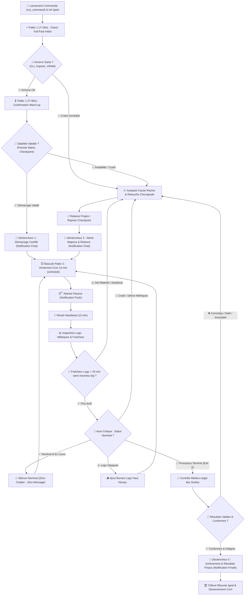
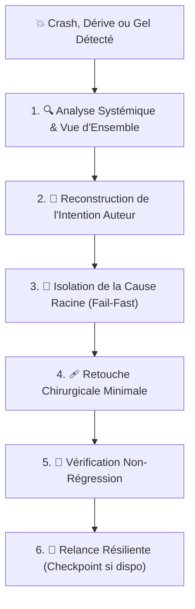

# 🛰️ Comment le Skill `monitor-command` Assure-t-il la Surveillance Autonome de Longues Pipelines ?

> **Aliases & Invocations** : `/monitor-command <commande>` | `/watch-command` | `/overnight-run`  
> **Modes Recommandés** : Toujours couplé à la commande `/goal` pour exécution nocturne sans interruption.  
> **Cadencement Canonique** : Double palier temporel — **Palier 1 Fail-Fast (T+30s & T+90s)** puis **Palier 2 Croisière (10 min)** via `schedule`.  

Le skill `monitor-command` dote l'agent d'un protocole de **pilotage et de vigie autonome en boucle fermée** pour superviser des commandes lourdes, des pipelines de recherche ou des entraînements longs (DVC, Cluster-CI, PyTorch, scripts d'annotation LLM). L'agent lance la commande en arrière-plan, applique un **double palier temporel** (détection précoce Fail-Fast à T+30s/T+90s puis régime de croisière silencieux toutes les 10 minutes), audite activement les logs et la fraîcheur d'émission (détection anti-deadlock > 20 min), s'auto-critique sans complaisance, résout chirurgicalement les incidents sans dénaturer l'intention du code, et ne s'arrête **qu'après validation médico-légale des résultats finaux**.

---

## 🔄 Comment s'Articule la Boucle de Surveillance Continue ?

Le diagramme ci-dessous illustre le cycle de vie complet de l'orchestration sous `/monitor-command` :



---

## 🏛️ Quels Sont les 8 Piliers Fondamentaux de la Doctrine `monitor-command` ?

### 1. 🌙 Pourquoi l'Autonomie Totale & le Mode Nocturne `/goal` Sont-ils Obligatoires ?

| Règle | Spécification Technique & Comportementale |
|---|---|
| **Contexte Nocturne** | Henri lance la commande avant de dormir ou de s'absenter : **il ne sera pas là pour répondre**. |
| **Interdiction d'Interruption** | INTERDICTION FORMELLE d'appeler `ask_question` ou de stopper l'exécution pour solliciter un arbitrage humain en cours de route. |
| **Couplage `/goal`** | Dès l'invocation de `/monitor-command`, l'objectif est verrouillé comme un `/goal` persistant qui ne prend fin que lorsque la commande a produit son résultat final vérifié. |
| **Objectivité & Rigueur** | Zéro complaisance, zéro hallucination, zéro déclaration prématurée de succès : seule la preuve matérielle brute valide l'avancement. |

---

### 2. ⏱️ Comment S'Articule le Double Palier de Surveillance Temporelle (Fail-Fast & Croisière 10 min) ?

La surveillance ne repose ni sur une boucle de polling bloquante ni sur une attente aveugle : elle utilise le mécanisme natif événementiel de l'environnement Antigravity articulé en **deux paliers temporels complémentaires** :

#### ⚡ Comment le Palier 1 Intercepte-t-il les Défaillances Immédiates (Fail-Fast T+30s & T+90s) ?

Le démarrage d'un script ou d'un pipeline est la phase la plus vulnérable aux erreurs bêtes ou de configuration d'environnement :

1. **Étape 1 (T+30s - Early Check)** :
   - Armer un premier timer rapide via `schedule(DurationSeconds=30, TimerCondition="<task-id>", Prompt="Check Fail-Fast T+30s : syntaxe CLI, imports, initialisation CUDA")`.
   - **Objectif** : Intercepter instantanément les erreurs d'amorce sans faire perdre 10 minutes (mauvaise syntaxe CLI, `ModuleNotFoundError`, mauvaise variable d'environnement, CUDA OOM dès l'allocation statique).
2. **Étape 2 (T+90s - Confirmation Warm-up)** :
   - Si T+30s est nominal, armer un second timer court via `schedule(DurationSeconds=60, TimerCondition="<task-id>", Prompt="Check Fail-Fast T+90s : stabilité du warm-up, premier batch, chargement checkpoints")`.
   - **Objectif** : Valider que la phase de warm-up est franchie, que les données se chargent correctement et que les premières itérations de calcul s'exécutent de façon stable.
3. **Certification Initiale** : La validation conjointe de T+30s et T+90s est la condition sine qua non pour déclencher la notification **Déclencheur 1 (Démarrage Certifié)** dans le chat.

#### 🚢 Comment Fonctionne le Palier 2 en Régime de Croisière Silencieux (Cadencement 10 Minutes) ?

Une fois le démarrage certifié validé à T+90s, l'agent bascule en régime de croisière silencieux :

1. **Armement Cron 10 Minutes** :
   ```json
   {
     "CronExpression": "*/10 * * * *",
     "Prompt": "Heartbeat 10 min monitor-command : auditer les logs, fraîcheur d'émission, débit, RAM/VRAM, détecter anomalies ou stagnation.",
     "IsDaemon": false,
     "toolAction": "Scheduling heartbeat",
     "toolSummary": "Monitor command heartbeat"
   }
   ```
2. **Attente Passive Absolue** : Ne JAMAIS utiliser de boucle d'attente active (`while True`), de `time.sleep()`, ni de polling bloquant. L'agent s'endort immédiatement après chaque audit et laisse le réveil push automatique faire son office.
3. **Silence Nominal Strict (Zero-Chatter)** : À chaque réveil de 10 minutes, si tout est nominal, l'agent reste **totalement silencieux** (zéro message émis).

---

### 3. 🔍 Quelle Est la Grille d'Auto-Critique Systématique à Chaque Heartbeat ?

À chaque notification de réveil, l'agent inspecte les flux de sortie stdout/stderr, la consommation de ressources, l'horodatage des sorties et les fichiers de métriques selon la grille suivante :

| Axe d'Audit | Indicateurs Concrets Analysés | Seuil d'Alerte / Action Immédiate |
|---|---|---|
| **Fraîcheur des Logs (Anti-Deadlock)** | Horodatage du dernier log émis (`mtime` ou timestamp console) vs heure actuelle. | **Aucun nouveau log depuis > 20 minutes** alors que le process est actif ➔ **Suspicion formelle de deadlock / gel matériel**. Déclenchement immédiat du diagnostic médico-légal. |
| **Progression & Débit** | Samples/s, it/s, tokens/s, pourcentage d'avancement des époques ou étapes. | Débit nul, chute brutale (>50% de ralentissement inexpliqué) ou stagnation. |
| **Temps d'Exécution** | Temps écoulé vs estimation nominale (ETA calculé). | Dépassement manifeste de l'ordre de grandeur théorique ➔ suspicion de boucle infinie. |
| **Santé Télémétrique** | Mémoire VRAM/RAM, température, allocations PyTorch. | Risque d'OOM imminent (`CUDA out of memory`), fuite mémoire incrémentale. |
| **Avertissements Suspects** | Logs stderr, warnings Python/CUDA/C++. | Détection de `UserWarning`, `FutureWarning` critiques, `nan/inf loss`, avertissements DDP ou NCCL timeouts. |
| **Visibilité des Logs** | Clarté et granularité du flux console. | Absence totale de repères temporels ou d'étape courante (opacité inacceptable). |
| **Inspection Critique des Artefacts Intermédiaires (DVC / ML)** | Lecture humaine d'échantillons réels produits à la fin de chaque nœud DVC / étape intermédiaire (textes générés, paires, distributions) sans attendre la fin du run complet. | Textes bruités/tronqués, fuite de Markdown/balises, dégénérescence stylistique ou heuristique factice ➔ **Arrêt immédiat du run, diagnostic racine et relance propre**. |

---

### 4. 🪵 Quelles Sont les Règles d'Hygiène Stricte des Logs (Zéro Log en Boucle) ?

> [!CAUTION]
> **INTERDICTION FORMELLE D'AJOUTER DES LOGS DANS LES BOUCLES INTÉRIEURES HAUTE FRÉQUENCE :**  
> L'ajout d'instructions de log (`print`, `logger.info`, `sys.stderr.write`) à l'intérieur d'une boucle de batch, d'itération par token ou de parcours d'échantillons est **STRICTEMENT INTERDITE**.  
> **Conséquences évitées** : Saturation de l'I/O disque, explosion de la taille des logs (fichiers de plusieurs gigaoctets), ralentissement drastique du runtime et blocage du terminal.

#### Quelles Sont les Règles de Bornage de Log Autorisé ?
Si la commande s'avère trop opaque et manque de suivi, l'agent est autorisé à instrumenter le code **uniquement aux bornes macroscopiques** :
1. **Bornes d'Étapes Majeures** : Avant et après le chargement du dataset, l'initialisation du modèle, le début et la fin d'une époque.
2. **Synthèses Périodiques Temporisées** : Uniquement via un pas modulaire élevé (ex: `if step % 500 == 0:` ou `if time.time() - last_log > 300:`).
3. **Format Structuré** : Toujours inclure un timestamp ISO, l'étape courante, le pourcentage d'avancement et la métrique pivot.

---

### 5. 🛡️ Pourquoi la Sanctuarisation des Configurations Système Est-elle Inviolable ?

> [!IMPORTANT]
> **INTÉGRITÉ DU CADRE D'EXÉCUTION & DU FICHIER `.cluster-ci` :**  
> Antigravity a l'interdiction formelle et absolue de modifier le fichier de configuration système `.cluster-ci`, les scripts d'ordonnancement Slurm ou les hyperparamètres fondamentaux de l'expérience pour "faciliter" le passage de la commande.

- **Non-Régression des Exigences** : Interdiction de diminuer `REQUIRED_RAM`, `REQUIRED_VRAM`, de raccourcir `MAX_RUNTIME_HOURS` ou d'éluder des étapes (`STAGES`).
- **Interdiction du Bâclage** : Interdiction formelle de réduire le nombre d'époques, de diviser la taille du dataset ou d'augmenter artificiellement le learning rate pour faire terminer la commande plus vite.
- **Respect de l'Objectif Scientifique** : La commande doit s'exécuter dans les conditions exactes et complètes prévues par Henri.

---

### 6. 🩺 Quel Est le Protocole de Résolution Chirurgicale & Respect de l'Intention Auteur ?

En cas de crash, d'anomalie bloquante constatée dans les logs ou de blocage persistant, l'agent agit avec une rigueur médico-légale :



#### Quels Sont les Principes Directeurs de Réparation Chirurgicale ?
1. **Zéro Masquage d'Erreur (Alignement Fail-Fast)** : Interdiction absolue d'ajouter des `try...except: pass` silencieux ou des valeurs par défaut cosmétiques (se référer impérativement à [`bonnes-pratiques-developpement.md`](file:///c:/Users/hjamet/Documents/VoiceNotes/_agents/rules/bonnes-pratiques-developpement.md)).
2. **Reconstruction de l'Intention Auteur** : Se demander : *« Que cherchait à accomplir l'auteur avec cette instruction ? Quel invariant mathématique ou logique était visé ? »*.
3. **Chirurgie vs Déformation** : Ne modifier que les quelques lignes nécessaires pour corriger l'incompatibilité de type, le chemin erroné, la dimension de tenseur ou le dépassement mémoire réel.
4. **Gestion Proactive des Blocages** : Si un processus est bloqué dans un deadlock DDP ou un état zombie, l'agent a l'obligation de tuer le processus proprement (`kill`), d'appliquer le correctif et de relancer.

#### Comment Diagnostiquer et Traiter un Gel Matériel ou un Deadlock (> 20 min sans logs) ?

Si la fraîcheur des logs dépasse le seuil critique de 20 minutes d'inactivité console :

1. **Inspection Médico-Légale Préalable** :
   - Vérifier l'état système via `manage_task(Action="status", TaskId="<task-id>")` ou inspection des processus (`nvidia-smi` pour vérifier si l'activité GPU est à 0% d'utilisation compute permanente, utilisation CPU à 0% ou bloquée à 100% sur un thread unique).
   - Différencier un gel réel d'une phase de calcul intensif normale documentée (ex: validation lourde sur dataset géant, compilation de graphe PyTorch 2.0).
2. **Traitement Résilient (Kill & Recovery)** :
   - Si le blocage matériel ou le deadlock inter-processus (ex: socket bloquée, barrière distribuée non libérée, freeze CUDA) est confirmé : interrompre immédiatement le processus (`manage_task` action `kill`).
   - Autopsier le point de blocage (dernière trace de pile, log d'initialisation réseau ou timeout NCCL).
   - Relancer proprement le pipeline à partir du dernier checkpoint valide sauvegardé.
   - Émettre la notification **Déclencheur 2 (Alerte Majeure & Relance)** documentant le gel matériel et la reprise opérée.

---

### 7. ⚖️ Comment Conduire le Contrôle Médico-Légal de Fin de Run & la Validation Finale ?

La commande qui retourne un code de sortie `0` n'est pas synonyme d'expérience réussie. L'agent effectue un audit approfondi avant de clore sa mission :

| Critère de Validation | Méthode de Vérification Factuelle | Résultat Requis pour Validation |
|---|---|---|
| **Intégrité des Sorties** | Inspection de la taille, date de modification et présence des fichiers générés. | Fichiers non vides, poids cohérent (poids de checkpoints non tronqués). |
| **Cohérence Statistique** | Scan des métriques enregistrées (CSV, JSON, Tensorboard, WandB). | Absence totale de valeurs `NaN`, `Inf`, ou de métriques dégénérées (ex: accuracy 0.00% constante). |
| **Convergence / Complétion** | Vérification de la dernière ligne des logs. | Mention explicite de fin nominale (`Finished successfully`, `100% completed`). |
| **Conformité aux Attentes** | Confrontation avec les livrables décrits dans la commande initiale. | 100% des artefacts requis sont disponibles et validés. |

---

### 8. 🔇 Quelle Est la Doctrine du Silence Nominal & les 3 Déclencheurs Exclusifs de Restitution ?

> [!IMPORTANT]
> **DOCTRINE DU SILENCE NOMINAL (ZERO-CHATTER) :**  
> Lors des réveils cron de routine cadencés toutes les 10 minutes, **tant que la télémétrie est saine, que le débit de calcul est nominal et qu'aucun crash, dérive ou gel n'est constaté, l'agent doit rester STRICTEMENT SILENCIEUX**.  
> **Interdiction Formelle du Bavardage de Routine** : Ne JAMAIS émettre de message intermédiaire de confort ou de statut verbeux (*« Tout va bien, époque 2 en cours... »*). Toute notification intermédiaire doit être rigoureusement justifiée par un événement pivot.

#### Quels Sont les 3 Déclencheurs Exclusifs de Restitution ?

L'agent n'émet des synthèses et notifications **QUE sous l'un des trois déclencheurs stricts et exclusifs suivants** :

| # | Déclencheur Exclusif | Condition Déclenchante | Contenu Obligatoire de la Restitution | Invariant & Preuve Matérielle |
|---|---|---|---|---|
| **1** | **🚀 Démarrage Certifié** | La commande a franchi avec succès le Palier 1 Fail-Fast complet (checks T+30s et T+90s validés sans crash). | PID/TaskId actif, confirmation des premiers batches/époques engagés, extrait brut des logs d'amorce validés. | Preuve irréfutable que le runtime est fonctionnel et stable (zéro `ImportError`, syntax error ou échec d'allocation CUDA immédiat). |
| **2** | **🚨 Alerte Majeure & Auto-Recovery** | Détection d'un crash, d'une anomalie bloquante (`loss NaN/Inf`, divergence), ou d'un gel matériel / deadlock constaté par > 20 minutes sans logs. | Diagnostic de cause racine (Fail-Fast), retouche chirurgicale ciblée appliquée, logs d'incident et identifiant de la relance (reprise sur checkpoint). | Émission réalisée **uniquement APRÈS autopsie et relance effective** du processus (zéro alerte creuse passive sans résolution). |
| **3** | **🏁 Achèvement & Résultats Finaux** | La commande s'est achevée avec succès (exit code 0) et les livrables ont validé l'audit médico-légal. | Synthèse médico-légale chiffrée, métriques finales certifiées, intégrité des artefacts vérifiée et durée totale du run. | **Interdiction formelle de notifier sur simple exit code 0** sans audit médico-légal approfondi préalable. |

---

## 📋 Quel Est le Protocole Opérationnel Étape par Étape pour l'Agent ?

| Phase | Rôle de l'Agent | Outils & Actions Concrètes | Restitution |
|---|---|---|---|
| **Phase 0 : Lancement & Palier 1 Fail-Fast** | Initier la commande et exécuter la validation précoce T+30s et T+90s. | Lancer via `run_command` en arrière-plan (`WaitMsBeforeAsync: 5000`). Armer `schedule` T+30s puis T+90s. Vérifier absence d'erreur d'amorce et premier batch. | **📢 Déclencheur 1 (Démarrage Certifié)** : Envoyer la preuve matérielle d'initialisation réussie dès la validation conjointe T+30s/T+90s. |
| **Phase 1 : Bascule Palier 2 & Armement Vigie** | Programmer la surveillance récurrente toutes les 10 minutes. | Utiliser `schedule` avec `CronExpression: "*/10 * * * *"` et `Prompt` explicite d'audit de télémétrie. | *Silence radio (aucun message émis).* |
| **Phase 2 : Veille, Audit de Fraîcheur & Silence Nominal** | À chaque réveil cron 10 min, auditer les logs, la fraîcheur (> 20 min) et le débit. | Vérifier le statut du task (`manage_task`), lire les logs récents (`view_file`), contrôler le timestamp du dernier log, calculer le débit et vérifier la RAM/VRAM. | **🤫 Silence Nominal (Zero-Chatter)** : **Zéro message** tant que le processus avance nominalement. |
| **Phase 3 : Détection (Crash ou Inactivité > 20 min) & Auto-Recovery** | Réagir immédiatement à tout crash, divergence ou gel matériel (> 20 min sans logs). | Tuer le process (`kill`), autopsier la cause racine (Fail-Fast), appliquer le patch chirurgical, relancer depuis le dernier checkpoint valide. | **📢 Déclencheur 2 (Alerte Majeure & Relance)** : Notifier la cause racine, le correctif apporté et la relance effectuée. |
| **Phase 4 : Contrôle Médico-Légal** | À l'arrêt du processus (exit 0), autopsier rigoureusement les livrables. | Scanner les fichiers produits, vérifier l'absence de `NaN`/`Inf`, tester l'intégrité et la cohérence des checkpoints/artefacts. | *Silence radio pendant l'investigation médico-légale.* |
| **Phase 5 : Clôture & Résultats Finaux** | Désactiver le cron et synthétiser les résultats finaux vérifiés. | Tuer le cronjob `schedule`, dresser le bilan chiffré des métriques atteintes et artefacts validés. | **📢 Déclencheur 3 (Achèvement & Résultats Finaux)** : Envoyer le rapport final complet certifié. |

---

## 💡 Quels Sont les Exemples Concrets d'Application & Scénarios Types ?

### Scénario A : Comment Surveiller un Entraînement PyTorch ou un Repro DVC ?
- **Commande** : `dvc repro train`
- **Surveillance 10 min** : Lecture des métriques d'évaluation dans `eval/metrics.json` et détection d'une éventuelle explosion du gradient.
- **Incident Rencontré** : Le GPU sature en mémoire à l'époque 3 (`CUDA out of memory` lors de la validation).
- **Résolution Chirurgicale** : L'agent identifie que l'évaluation n'utilise pas le context manager `torch.no_grad()`, ce qui accumule les graphes d'autograd. L'agent insère `with torch.no_grad():` autour de la boucle de validation sans modifier ni la taille de batch ni le modèle, et relance depuis le checkpoint de l'époque 2.

### Scénario B : Comment Monitorer un Pipeline Distribué Cluster-CI ou Slurm ?
- **Commande** : `cluster-run submit experiment_v2.sh`
- **Surveillance 10 min** : Interrogation périodique du statut du job sur le headnode.
- **Sanctuarisation** : L'agent constate que le nœud met 8 minutes à préchauffer le conteneur Docker. L'agent ne modifie pas `.cluster-ci` pour forcer un autre nœud, il patiente méthodiquement en validant l'arrivée des logs d'initialisation.

### Scénario C : Comment Piloter un Script d'Annotation Massive par LLM ?
- **Commande** : `python scripts/annotate_dataset.py --input raw_data.jsonl --output annotated.jsonl`
- **Surveillance 10 min** : Calcul du débit d'appels API par minute.
- **Hygiène des Logs** : L'agent note que la console est totalement muette depuis 40 minutes sans progression. Conformément au seuil critique de 20 minutes, l'agent inspecte le statut, tue le processus gelé sur un timeout socket non catché, ajoute un timeout explicite et une ligne de statut affichant un résumé tous les 1000 items traités (`[INFO] 2026-09-22 14:00:00 - Traités : 4000/50000 (8.0%) - Débit : 12.5 items/s`), puis relance depuis le dernier élément annoté.

---

## 🚨 Quels Sont les Anti-Patterns Formellement Proscrits ?

| Anti-Pattern Interdit ❌ | Risque Associé | Comportement Requis Conforme ✅ |
|---|---|---|
| **Interrompre pour demander l'avis d'Henri** | Blocage total du pipeline pendant la nuit. | Autonomie absolue : diagnostiquer, corriger chirurgicalement et relancer. |
| **Court-circuiter le Palier 1 Fail-Fast** | Déclarer un démarrage certifié prématuré alors que le script plante à T+40s. | Respecter la vérification conjointe T+30s (amorce) et T+90s (warm-up). |
| **Ignorer l'absence de logs > 20 min** | Laisser tourner indéfiniment un processus en deadlock ou en gel matériel. | Alerte anti-deadlock : investiguer dès 20 min sans logs, kill et relance sur checkpoint. |
| **Insérer un `print` dans une boucle batch** | Ralentissement I/O majeur, saturation disque. | Log périodique uniquement aux bornes ou tous les $N$ batches ($N \ge 100$). |
| **Modifier `.cluster-ci` pour passer en force** | Violation des contraintes d'infrastructure. | Sanctuarisation absolue du fichier de configuration cluster. |
| **Ajouter un `try/except: pass` silencieux** | Corruption indétectable de l'expérimentation. | Règle Fail-Fast : traiter la cause racine exacte sans masquer l'exception. |
| **Envoyer des messages de routine à chaque réveil cron (Chatter)** | Saturation du fil de discussion et bruit inutile. | Silence Nominal strict : émettre exclusivement sur les 3 déclencheurs certifiés. |
| **Déclarer le succès dès l'exit code 0** | Livrables vides ou fichiers corrompus ignorés. | Contrôle médico-légal obligatoire des fichiers et des métriques avant validation. |
